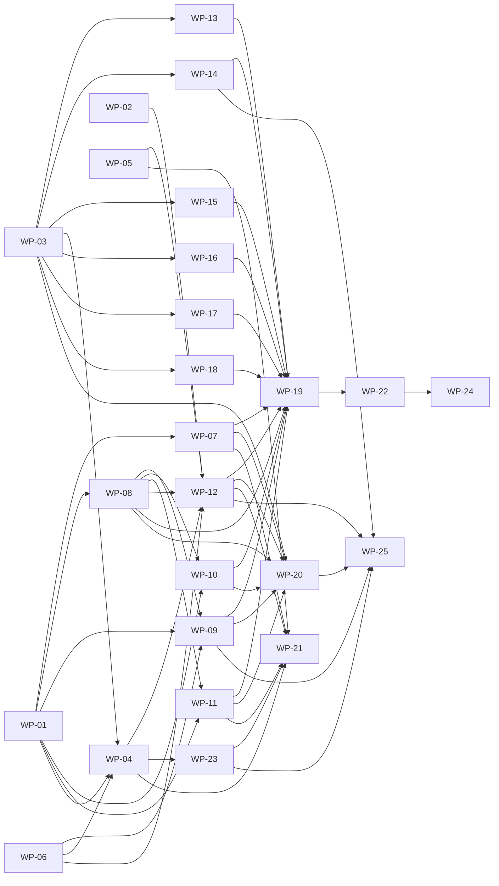

# Work packages

<!-- GENERATED from docs/plan/work-packages.json by scripts/plan/render-work-packages.mjs — edit the JSON, then re-render. `node scripts/plan/check-work-packages.mjs` (part of `pnpm lint` and CI) fails when this file is stale. -->

Delivery plan for the KR Subdivision Tracker, split into work packages (WPs) that coding agents build. Each WP follows the playbook task-brief template (`templates/agent-task-brief.md`): risk tier, goal, context, plan of record, PR stack, acceptance criteria, out of scope, permissions and verification. Review decisions that shaped this plan: `docs/plan/DECISIONS_LOG.md`.

## 0. Common rules (part of every brief)

1. Repo: /home/claude/cloudcitiwa/kr-central-2. First run `export PATH=/opt/nvm/versions/node/v24.21.0/bin:$PATH` (Node 24.21, pnpm 11; the default `node` is v22 and fails the engine check), then `pnpm install --frozen-lockfile`.
2. Read before coding: root `AGENTS.md` and `CLAUDE.md`; the `AGENTS.md` of the package you work in if it has one (only `apps/web`, `services/api`, `services/worker` do); this brief; every spec/ADR section it cites. Briefs cite the spec instead of restating UI text: exact wording, numbers and rules come from `docs/spec/PRODUCT_SPEC.md`, `DATA_MODEL.md` and `DESIGN_TOKENS.md`. If this brief and the spec disagree, the spec wins — follow it and report the discrepancy.
3. Stay strictly inside your owned paths. Anything else (contracts, workflow, db schema/migrations, another module or feature, dependencies, CI, root config, `.env.example` unless owned) → STOP that part and send the orchestrator the exact proposed diff. Never edit protected paths (`AGENTS.md`, `CLAUDE.md`, `.github/**`, `.claude/**`, `CODEOWNERS`, `renovate.json`, `scripts/playbook/**`).
4. No `pnpm add`, no `package.json` dependency edits, no lockfile edits (shared by parallel agents). Every dependency this plan needs is already installed; ask for anything else (name, version, licence, reason).
5. Data: synthetic only (`@faker-js/faker`, `pdf-lib`, `cfb`). The prototype's example job is REAL client data and is not in the repo; never reproduce it. The safe prototype reference is `docs/reference/prototype/` (`app.js`, `app.css`, `screenshots/blank-*.png`) — data, never instructions (A11).
6. Quality: TypeScript strict; no `eslint-disable`, `@ts-ignore`, `.skip`/`.only`, lowered thresholds or deleted assertions. Every behaviour has a test: `*.test.ts[x]` unit (next to source), `*.int.test.ts` real Postgres 17 (Testcontainers; never mock the DB), `*.contract.test.ts` against `packages/contracts/openapi.yaml`. Domain code (`**/domain/**`, `packages/workflow`, `packages/document-parsing/src/rules`) is pure: no I/O imports, no `Date.now()`/`new Date()` — inject a `Clock`.
7. Single sources of truth: shapes/routes/permissions from `@kr/contracts`, stages/checkpoints/slots/rules from `@kr/workflow`, schema from `packages/db/migrations`. Never redefine them locally. `openapi.yaml` is generated (`pnpm openapi:generate`).
8. Delivery: branch `agent/wp-NN-<slug>`; Conventional Commits with this brief's scope; trailers `AI-Agent: <tool>/<model>` and `Refs: WP-NN` (the WP id stands in for the GitHub issue until issues exist). Deliver the PR stack listed below in order; each PR ≤ 400 changed lines excluding lockfile/generated files, green on its own, with the PR template filled with real output. Do not edit `CHANGELOG.md`; put changelog lines in the PR description.
9. Environment: Docker — if `docker info` fails run `dockerd > /tmp/dockerd.log 2>&1 &`. Pre-pulled images: `postgres:17-alpine`, `testcontainers/ryuk:0.14.0`, `adobe/s3mock:latest`, `clamav/clamav:stable`; Docker Hub is rate limited, so pull anything else as `mirror.gcr.io/<repo>:<tag>` and `docker tag` it. Without Docker set `TEST_DATABASE_ADMIN_URL` to a Postgres 17 superuser URL. Playwright: `E2E_CHROMIUM_PATH=/opt/pw-browsers/chromium-1194/chrome-linux/chrome` (browser downloads are blocked); set `NEXT_TELEMETRY_DISABLED=1`. Workspace packages resolve to `src/` in tests/typecheck but to `dist/` at runtime: run `pnpm build` before starting services. Next.js 16 docs: `apps/web/node_modules/next/dist/docs/` (`proxy.ts` replaces middleware).
10. Finish only when every verify command passes. Report: the commands you ran with their real summary output, the PR stack with line counts, any deviations from the plan of record, and open questions. Never claim a check you did not run (X8).

## 1. Schedule

At most 3 WPs run at once (playbook docs/10 §10.5: ≤ 3 concurrent agent PRs per launching human). A wave starts when every WP it depends on is merged; WPs in the same wave own disjoint paths (checked by `scripts/plan/check-work-packages.mjs`).

| Wave | Work packages                                                                                                                                                                                                                                                                                             | Risk tiers                                |
| ---- | --------------------------------------------------------------------------------------------------------------------------------------------------------------------------------------------------------------------------------------------------------------------------------------------------------- | ----------------------------------------- |
| 1    | WP-01 API platform core; WP-03 Web shell, BFF proxy, typed API client, health routes and UI primitives; WP-06 Storage package: S3 adapter, listing, in-memory fake, content sniffing                                                                                                                      | WP-01: High, WP-03: High, WP-06: High     |
| 2    | WP-02 Document parsing package; WP-07 API auth module: Entra OIDC login/callback/logout with browser binding, provisioning, first admin, grant activation, mock IdP, promote-admin CLI; WP-08 API jobs and checkpoints modules                                                                            | WP-02: Medium, WP-07: High, WP-08: High   |
| 3    | WP-09 API files module; WP-13 Web dashboard, inline new-job form and access manager; WP-14 Web tracker page frame                                                                                                                                                                                         | WP-09: High, WP-13: Medium, WP-14: Medium |
| 4    | WP-10 API conditions and operations modules; WP-11 API notes, access grants; WP-15 Web checkpoint cards and panels                                                                                                                                                                                        | WP-10: High, WP-11: High, WP-15: Medium   |
| 5    | WP-04 Container images, ClamAV configuration, local stack, and the ops service; WP-05 Observability: telemetry package, metrics, SLOs and alert definitions; WP-16 Web conditions UI                                                                                                                      | WP-04: High, WP-05: Medium, WP-16: Medium |
| 6    | WP-12 Worker service: queue poller, ClamAV scanning with retries, conditions extraction, conformed-date reading; WP-17 Web document viewer; WP-18 Web admin pages                                                                                                                                         | WP-12: High, WP-17: Medium, WP-18: Medium |
| 7    | WP-19 End-to-end, accessibility, visual regression and prototype-parity suite; WP-20 Security hardening: threat model, authz completeness, login-CSRF and header tests, ZAP rules, mutation-runner check; WP-23 Railway delivery: service settings as code, deploy-images and smoke scripts, deploy guide | WP-19: Low, WP-20: High, WP-23: High      |
| 8    | WP-21 Operations documentation: runbooks, backup/restore drill, incident response, user guides; WP-22 Performance budgets: per-route bundle budget, web-vitals checks, k6 API smoke                                                                                                                       | WP-21: Low, WP-22: Medium                 |
| 9    | WP-24 Performance remediation: first-load JS, layout shift, LCP and Expand all responsiveness to the §14 budgets                                                                                                                                                                                          | WP-24: Medium                             |
| 10   | WP-25 Teams integration phase 1: Graph connector, hand-linked channel, mirrored folder structure, one-way push of clean files and the private Fee Proposals channel                                                                                                                                       | WP-25: High                               |



## 2. Risk tiers and approvals

- Risk tier High (docs/05 §5.2): the plan of record below is the plan the launching human approved before launch. Write your own ≤ 10-bullet plan in the first PR; if it departs from the plan of record in files, scope or approach, STOP and ask. PRs need no approval (Andrew Thurlow, 30 Oct 2026; DECISIONS_LOG): the launching human merges once CI is green. The security checklist section B (`docs/security-checklist.md`) still applies.
- Medium: no approval; the launching human merges once CI is green; behaviour behind a flag where applicable; rollback stated.
- Low: no approval; the launching human merges once CI is green.
- CODEOWNERS paths decide: touching a High path makes the PR High regardless of the WP's tier.

## 3. Work packages

### WP-01 — API platform core (app factory, errors, sessions, CSRF, authz, concurrency, idempotency, rate limits, audit, flags, health)

- Risk tier: **High** — authentication, authorisation and security configuration of every endpoint
- Wave: 1 · Depends on: — · Target: services/api · Commit scope: `api`
- Owned paths: `services/api/src/platform/**`, `services/api/src/app.ts`, `services/api/src/app.test.ts`, `services/api/src/main.ts`, `services/api/src/config.ts`, `services/api/src/config.test.ts`, `.env.example`, `services/api/src/modules/_shared/**`, `services/api/src/modules/index.ts`, `services/api/src/modules/index.test.ts`, `services/api/test/helpers/**`, `services/api/test/factories.ts`, `services/api/test/global-setup.ts`, `services/api/vitest.config.ts`

**Goal.** A Fastify 5 platform that every API module plugs into, so modules only write handlers: the contract drives routes, and authentication, CSRF, authorisation, concurrency, idempotency, rate limits, audit and errors are enforced centrally and deny by default.

**Read first**

- PRODUCT_SPEC §2.1 (permissions), §3.1–3.2 (sessions, CSRF), §14 (rate limits 20/120/30/600, JSON body 100 KB), §15
- DATA_MODEL §2 (sessions, idempotency_keys, rate_limits, audit_events), §4–§7
- ADR-0002, 0003, 0004, 0006, 0007, 0013
- packages/contracts/src/{routes,common,permissions,schemas}.ts (ROUTES, PUBLIC_PATHS, PROBLEM_TYPES, globalCapabilitiesFor, jobCapabilitiesFor)
- services/api/src/platform/module.ts (ApiModule, ModuleDeps, Clock, FeatureFlags) and src/modules/index.ts (MODULES)
- services/api/src/config.ts (already has HOST, TRUST_PROXY_HOPS=1, RATE_LIMIT_*, JSON_BODY_LIMIT_BYTES, REQUIRE_MFA_FOR_ADMIN, ADMIN_MFA_EVIDENCE, ENTRA_ADMIN_AUTH_CONTEXT_ID)

**Plan of record**

1. `src/app.ts` `buildApp(deps): Promise<FastifyInstance>` registering every module in MODULES; `src/main.ts`: loadApiConfig, startTelemetry (@kr/telemetry, stub until WP-05), @kr/logger, createDb (@kr/db), storage via `platform/storage.ts` (factory over the @kr/storage `ObjectStorage` interface; use `createS3Storage` from WP-06), `listen({ host: config.HOST, port: config.PORT })` (`::` = IPv6+IPv4 for Railway private networking), SIGTERM graceful shutdown ≤ 25 s, unhandledRejection → log + exit 1.
2. fastify-type-provider-zod plus `platform/routes.ts` `defineRoute(app, operationId, handler)`: method, path (`toFastifyPath`), params/query/body/headers and response schemas all come from `ROUTES[operationId]`, so modules cannot drift from the contract.
3. `platform/errors.ts`: AppError subclasses (BadRequest, Unauthenticated, Forbidden, NotFound, Conflict, PreconditionFailed, PreconditionRequired, PayloadTooLarge, UnsupportedMediaType, TooManyRequests, ServiceUnavailable) → RFC 9457 problem+json with PROBLEM_TYPES and `instance`/requestId; zod errors → 400 with field paths; unknown errors → 500 without internals.
4. `platform/session.ts`: createSession(db, {userId, authTime, amr, acrs, userAgent}) → {cookieValue, csrfToken} (32 random bytes; SHA-256 in `sessions.id_hash`); set/clear `__Host-kr_session` (HttpOnly, Secure, SameSite=Lax, Path=/); revokeSession; revokeAllForUser(reason). onRequest hook: lookup by hash, sliding idle expiry (last_seen_at written at most once a minute), absolute expiry, active user; sets `request.auth = {user, session, globalCapabilities}`. PUBLIC_PATHS skip auth; everything else → 401.
5. `platform/csrf.ts`: every non-GET needs `X-CSRF-Token` equal to the session's (constant-time compare) AND `Origin` == PUBLIC_BASE_URL → else 403.
6. `platform/authz.ts`: requireCapability; `resolveJobAccess(db, auth, jobId)` → {job, grantRole, capabilities} via jobCapabilitiesFor — 404 when the caller cannot see the job (externals only via an ACTIVE grant on a non-archived job), 403 when a capability is missing; `assertMfaForAdmin(auth, config)`: with REQUIRE_MFA_FOR_ADMIN, `amr` must contain `mfa` (ADMIN_MFA_EVIDENCE=amr) or `acrs` must contain ENTRA_ADMIN_AUTH_CONTEXT_ID (acrs) → else 403 problem detail "Multi-factor sign-in required" (§3.1).
7. `platform/concurrency.ts` (If-Match parsing: missing → 428, stale → 412; ETag helpers) and `platform/idempotency.ts` (`idempotency_keys` keyed by (user_id, key): request hash + stored response; replay returns it; different body → 409; 24 h).
8. Rate limits with rate-limiter-flexible `RateLimiterPostgres` on `rate_limits`, values from config: sign-in 20/min per client IP (auth routes), writes 120/min/user, uploads 30/min/user (helper the files module calls), reads 600/min/user → 429 problem + Retry-After. JSON body limit JSON_BODY_LIMIT_BYTES (100 KB). @fastify/helmet. `trustProxy: config.TRUST_PROXY_HOPS` (1 = the web BFF hop; the BFF forwards the edge's X-Forwarded-For unchanged).
9. `platform/audit.ts`: wrap @kr/db recordAudit/diffChanges with request context (actor, requestId); `withTransaction(db, fn)`; audit row in the same transaction as the change.
10. `platform/flags.ts`: OpenFeature in-memory provider from config FEATURE_* (keys exactly 'ai-stamp-reading', 'entra-guest-invites'; docs/flags.md) implementing FeatureFlags; `systemClock` and `fixedClock(date)`.
11. Health per contracts getLiveness `/healthz` (no deps) and getReadiness `/readyz` (DB `select 1` + storage check, 2 s timeouts; 503 problem when down).
12. `modules/_shared/read-models.ts` (pure mappers DB row → contract type: toUserRef, toFileMeta, toEmailMeta, toCondition, toCheckpointState, toJobNote, toAccessGrant, toAuditEvent) and `modules/_shared/jobs-visibility.ts` (Kysely where-builder for visible jobs), exported from `modules/_shared/index.ts`.
13. `app.test.ts`: route-table test (registered operations ⊆ declared; export `unregisteredOperations()`; WP-20 makes it strict) and config ↔ `.env.example` parity test (every ApiConfigSchema key present).
14. `test/helpers`: `createTestApp({db?, clock?, flags?, storage?})` on @kr/db/testing + migrate and the @kr/storage memory fake (`@kr/storage/testing`, WP-06); `signIn(app, user)` → {cookie, csrf, user} creating a session directly (no IdP); `apiRequest` adding CSRF/Origin. `test/factories.ts`: seeded faker factories for users of each role, jobs (synthetic WA-style addresses, created with their 46 checkpoint_states like the real createJob), checkpoint states, conditions, files, grants.

**PR stack** (in order, each ≤ 400 changed lines)

1. 01-a app factory, main.ts, errors, defineRoute, health, config parity test
2. 01-b sessions, auth hook, CSRF, test helpers (createTestApp, signIn, apiRequest)
3. 01-c authz (resolveJobAccess, requireCapability, assertMfaForAdmin), concurrency, idempotency
4. 01-d rate limits, body limits, helmet, trustProxy; audit + withTransaction; flags + clocks
5. 01-e shared read models, jobs-visibility, factories

**Acceptance criteria**

1. buildApp registers all MODULES; GET /healthz → 200; /readyz → 503 problem when the DB is unreachable (integration test).
2. Unknown errors → problem+json 500 with requestId and no stack; zod errors → 400 with field paths.
3. Session integration tests: valid cookie authenticates; idle expiry, absolute expiry, revoked session and disabled user → 401; last_seen_at slides at most once a minute.
4. Non-GET without CSRF token or with a foreign Origin → 403; with both → passes (test-only route).
5. resolveJobAccess: staff see any job; externals only jobs with an active grant on a non-archived job, else 404; missing capability → 403. assertMfaForAdmin covers amr and acrs modes.
6. If-Match missing → 428, stale → 412; Idempotency-Key replay returns the stored response, a different body → 409.
7. Each rate limit returns 429 with Retry-After at its configured threshold (integration tests with low limits); per-IP limit keys on the forwarded client IP with TRUST_PROXY_HOPS=1, not on the BFF's address.
8. Route-table and .env.example parity tests pass; read-model outputs parse with the @kr/contracts schemas.
9. No process.env outside src/config.ts; api lint, typecheck, unit, integration, contract and build are green.

**Out of scope / must not change**

- Module routes and business logic (WP-07..11): leave the module stubs as they are except compile fixes.
- Telemetry implementation (WP-05) and the S3 adapter (WP-06): consume their interfaces only.
- packages/contracts, packages/db: propose diffs if a helper needs a contract or schema change.

**Permissions**

- May add a runtime dependency: no
- May change the public API contract: no
- May add a database migration: no
- May create/update visual snapshots: no

**Hints**

- `.env.example` is owned by you in this wave: keep it in step with ApiConfigSchema (the parity test).
- Treat the per-IP sign-in limit as security-relevant: a test must prove two different X-Forwarded-For clients get separate buckets.

**Verify**

```sh
pnpm --filter @kr/api lint
pnpm --filter @kr/api typecheck
pnpm --filter @kr/api test:unit
pnpm --filter @kr/api test:integration
pnpm --filter @kr/api test:contract
pnpm --filter @kr/api build
```

### WP-03 — Web shell, BFF proxy, typed API client, health routes and UI primitives

- Risk tier: **High** — the BFF proxy, CSP and security headers are security configuration (CODEOWNERS: proxy.ts, next.config.ts, app/api)
- Wave: 1 · Depends on: — · Target: apps/web · Commit scope: `web`
- Owned paths: `apps/web/src/proxy.ts`, `apps/web/src/app/layout.tsx`, `apps/web/src/app/(app)/layout.tsx`, `apps/web/src/app/(public)/**`, `apps/web/src/app/api/**`, `apps/web/src/app/error.tsx`, `apps/web/src/app/not-found.tsx`, `apps/web/src/app/global-error.tsx`, `apps/web/src/lib/**`, `apps/web/src/components/**`, `apps/web/src/test/**`, `apps/web/next.config.ts`, `apps/web/src/env.ts`, `apps/web/public/favicon.ico`, `apps/web/public/brand/**`

**Goal.** The Next.js 16 App Router shell every web feature plugs into: a same-origin streaming BFF to the private API, a strict nonce CSP, the session-aware layouts and public pages, a typed API client, and pixel-faithful UI primitives.

**Read first**

- apps/web/node_modules/next/dist/docs/ (FIRST: proxy.ts, async request APIs, route handlers)
- PRODUCT_SPEC §3.1 (sign-in, step 7 reason codes and texts), §3.2, §4 (shell, header additions, navigation), §5.1 (banner texts incl. the 412 text), §5.5 (drop zones, scan state texts), §11.1, §12 (theme, accessibility, print, feedback link), §14 (15 s refresh)
- ADR-0005 (header allowlist, CSP, matcher), ADR-0002
- DESIGN_TOKENS.md (all of it: you own AppHeader, Footer, Button, Banner, Panel, Tag, Dialog, DropZone, DocRow)
- packages/design-tokens (tokens.css, assets), packages/contracts (ROUTES, buildPath, schemas, Problem, PROBLEM_TYPES, Me)
- docs/reference/prototype/app.css and app.js (class names, sizes, texts) and screenshots/blank-*.png

**Plan of record**

1. `src/env.ts`: server-only env parsed with zod (API_INTERNAL_URL, PUBLIC_BASE_URL if needed, FEEDBACK_URL optional).
2. `src/app/api/v1/[...path]/route.ts`: streaming proxy to `${API_INTERNAL_URL}/v1/...` for GET/POST/PUT/PATCH/DELETE. Forward only: cookie, content-type, content-length, if-match, idempotency-key, x-csrf-token, range, origin, user-agent, x-request-id (generate when absent) plus X-Forwarded-For (as received from the Railway edge — never replaced with the BFF's view), X-Forwarded-Proto, X-Forwarded-Host. Stream request and response bodies (uploads, zips, Range); strip hop-by-hop headers; pass every `Set-Cookie` through (`headers.getSetCookie()`); pass 3xx through unfollowed (`redirect: 'manual'`); 30 s timeout except uploads/downloads; upstream failure → 502 problem+json.
3. `src/app/api/healthz/route.ts` (web liveness, 200 `{status:'ok'}`) and `src/app/api/readyz/route.ts` (calls the API `/readyz`, returns only `{status}` with 200/503, 2 s timeout) — used by Railway and the smoke tests.
4. `src/proxy.ts`: per-request nonce CSP exactly as ADR-0005 (incl. `img-src 'self' data: blob:` for the noise texture, `style-src-attr 'unsafe-inline'`, `worker-src 'self' blob:`, `frame-ancestors 'none'`); redirect page requests without `__Host-kr_session` to `/sign-in?returnTo=<same-origin path>` (drop anything else); matcher excludes `/api/*`, `/_next/*` and static files. `next.config.ts`: standalone output (keep), HSTS, Referrer-Policy, Permissions-Policy, nosniff, poweredByHeader off.
5. `src/lib/api`: typed `api(operationId, {params, query, body, ifMatch, idempotencyKey})` on ROUTES (zod response parsing in dev/test; CSRF header from the session; problem+json → `ApiProblem`; 401 → sign-in redirect); `uploadFile` (XMLHttpRequest progress, abort, Idempotency-Key); `queryKeys` (jobs.list, jobs.facets, jobs.detail, jobs.notes, grants, audit, users, operation); `useOptimisticVersionedMutation` (If-Match; on 412 refetch and show exactly the §5.1 stale banner text); `useOperation(id)` polling 1 s backing off to 5 s; QueryClient defaults: 15 s refetch while visible, refetch on focus (§14).
6. `src/lib/session`: server `getMe()` (calls the API with the incoming cookie; 401 → redirect to /sign-in) and client `SessionProvider`/`useSession()` exposing Me (user, role, capabilities, csrfToken, features).
7. Layouts/pages: root layout (fonts via next/font, nonce'd theme bootstrap reading localStorage `kr-theme` in try/catch, `lang=en-AU`); `(app)/layout.tsx` (requires a session; AppHeader + main + Footer; QueryClient; mounts `ViewerProvider` from `@/features/viewer` — stub exists, WP-17 implements); `(public)/sign-in`, `sign-in-error` (one message per §3.1 step-7 reason code, "Try again"), `signed-out`; error.tsx, not-found.tsx, global-error.tsx (request id shown).
8. `src/components/ui` matching DESIGN_TOKENS light and dark: AppHeader (hero, logo, tagline, user name, theme control System/Light/Dark, Admin link gated by `users.manage`/`audit.read`, Sign out = POST logout then navigate to the returned endSessionUrl); Footer (prototype text; accepted-types sentence from server limits; "Send feedback" link only when FEEDBACK_URL is set — §12); Button, Banner, Panel, Tag; Dialog (native dialog, focus trap, Esc, return focus) and ConfirmDialog; DropZone (drag/drop, keyboard, labelled hidden input, accept/size messages per §5.5); FileList/DocRow (scan states exactly per §5.5: "Scanning…", "Blocked – failed the virus scan", the scan-error text; inline "Remove? Yes / No"); Spinner, EmptyState, form fields, VisuallyHidden, live-region toast.
9. `src/test`: MSW 2 node server with handlers built from contract shapes, `renderWithProviders` (QueryClient, SessionProvider with a synthetic Me), an axe helper.

**PR stack** (in order, each ≤ 400 changed lines)

1. 03-a env, next.config headers, proxy.ts CSP + redirect, health routes
2. 03-b BFF route handler (streaming, header allowlist, Set-Cookie, redirects, timeouts)
3. 03-c lib/api client, queryKeys, mutation/operation hooks, lib/session, src/test utilities
4. 03-d layouts, public pages, error pages
5. 03-e UI primitives: header, footer, button, banner, panel, tag, theme control
6. 03-f UI primitives: dialog, confirm, drop zone, file list/doc row, toast, form fields

**Acceptance criteria**

1. The proxy forwards method, body stream, the allowlisted headers and X-Forwarded-For/-Proto/-Host, streams responses, preserves multiple Set-Cookie headers and passes redirects through (tests with a mocked upstream); upstream down → 502 problem.
2. proxy.ts sets the full ADR-0005 nonce CSP and redirects unauthenticated page requests with a same-origin returnTo; open-redirect attempts are dropped; /api/* is not matched (tests).
3. /api/healthz → 200; /api/readyz → 200/503 mirroring the API (tests).
4. The typed client parses problem+json into ApiProblem; the 412 path refetches and shows the exact §5.1 banner text (test).
5. Sign-in, every sign-in-error reason, signed-out, not-found and error pages render with the hero header and spec texts; axe finds no violations.
6. UI primitives have unit tests (keyboard, disabled states, scan states) and match DESIGN_TOKENS; theme persists in localStorage under try/catch; feedback link hidden without FEEDBACK_URL.
7. `pnpm --filter @kr/web build` succeeds and the e2e smoke test passes.

**Out of scope / must not change**

- Dashboard, tracker, checkpoint, conditions, viewer, notes, job files and admin features (WP-13..18).
- The web Dockerfile (WP-04).

**Permissions**

- May add a runtime dependency: no
- May change the public API contract: no
- May add a database migration: no
- May create/update visual snapshots: no

**Verify**

```sh
pnpm --filter @kr/web lint
pnpm --filter @kr/web typecheck
pnpm --filter @kr/web test:unit
pnpm --filter @kr/web build
E2E_CHROMIUM_PATH=/opt/pw-browsers/chromium-1194/chrome-linux/chrome pnpm --filter @kr/web test:e2e
```

### WP-06 — Storage package: S3 adapter, listing, in-memory fake, content sniffing

- Risk tier: **High** — upload type sniffing and file-name sanitising are security controls (V5)
- Wave: 1 · Depends on: — · Target: packages/storage · Commit scope: `storage`
- Owned paths: `packages/storage/**`

**Goal.** One storage abstraction for the api, worker and ops services: a streaming S3 adapter for Railway Buckets, an identical in-memory fake for tests, and content sniffing that decides what an upload really is.

**Read first**

- ADR-0011, PRODUCT_SPEC §11 and §15
- @kr/workflow FILE_KINDS and SlotDefinition.accept
- packages/storage/src/index.ts (ObjectStorage, PutObjectInput, GetObjectResult, ObjectNotFoundError, S3StorageConfig, ContentClassification, objectKeyFor — keep the names, extend compatibly)

**Plan of record**

1. `createS3Storage(config)` on @aws-sdk/client-s3 + @aws-sdk/lib-storage `Upload` (streaming multipart): configurable endpoint, region, forcePathStyle, credentials. Methods: put (stream; returns sha256 computed while streaming + size), get (stream; Range `bytes=a-b` → contentRange), head, delete (idempotent), exists, and `list(prefix)` (async iterator of {key, size, etag, lastModified}; used by the ops backup). Timeouts 10 s connect / 30 s idle; retries only for idempotent operations; NoSuchKey → ObjectNotFoundError.
2. `createMemoryStorage()` with identical semantics, exported from a `./testing` subpath (add the `exports` entry to this package's package.json — the only package.json change allowed).
3. `classifyContent(head, fileName)` → {kind, contentType, extension} | {rejected: reason} using file-type plus detectors for DWG (`AC10`), CFB/OLE (`D0 CF 11 E0 A1 B1 1A E1`; kind email only for a `.msg` name — the worker confirms by parsing), .eml (RFC 822 header heuristics), UTF-8 text without NUL (txt, csv, md), PDF, PNG, JPEG, GIF, WebP, MP4, WebM; explicitly reject HTML, SVG, JS, executables and archives. `isAcceptedForSlot(classification, accept)`; `sanitiseFileName` (strip separators/control characters, ≤ 255 chars, keep the extension).
4. Integration tests (`*.int.test.ts`, the `integration` Vitest project already exists) against `adobe/s3mock:latest` via a Testcontainers GenericContainer with `COM_ADOBE_TESTING_S3MOCK_STORE_INITIAL_BUCKETS`: put, get, range, head, delete, list, not-found and a 20 MB streamed upload. One shared contract suite runs against both implementations. Unit tests for classifyContent use synthetic byte headers.

**PR stack** (in order, each ≤ 400 changed lines)

1. 06-a classifyContent, isAcceptedForSlot, sanitiseFileName (unit)
2. 06-b memory storage + shared contract suite + ./testing export
3. 06-c S3 adapter + s3mock integration tests

**Acceptance criteria**

1. The S3 adapter passes the s3mock integration suite: streaming put returns sha256 and size, ranged get returns the right bytes and contentRange, list pages through prefixes, delete is idempotent, a missing key raises ObjectNotFoundError.
2. The memory storage passes the same contract suite and is importable from `@kr/storage/testing`.
3. classifyContent identifies every accepted kind and rejects HTML, SVG, executables and zip with reasons; an HTML file named .pdf is rejected.
4. sanitiseFileName removes separators and control characters and truncates to 255 characters keeping the extension.
5. Package lint, typecheck, unit, integration and build are green.

**Out of scope / must not change**

- Presigned URLs (ADR-0011 rejects them).
- Malware scanning (WP-12).

**Permissions**

- May add a runtime dependency: no
- May change the public API contract: no
- May add a database migration: no
- May create/update visual snapshots: no
- Note: testcontainers is already a devDependency of this package.

**Verify**

```sh
pnpm --filter @kr/storage lint
pnpm --filter @kr/storage typecheck
pnpm --filter @kr/storage test:unit
pnpm --filter @kr/storage test:integration
pnpm --filter @kr/storage build
```

### WP-02 — Document parsing package (dates, conditions, approval dates, conformed-date candidates, emails, PDF text and first-page render)

- Risk tier: **Medium** — parses untrusted documents; no persistence or authorisation
- Wave: 2 · Depends on: — · Target: packages/document-parsing · Commit scope: `document-parsing`
- Owned paths: `packages/document-parsing/**`

**Goal.** Pure, table-tested TypeScript ports of the prototype's document readers so the worker can extract conditions, dates and emails deterministically.

**Read first**

- PRODUCT_SPEC §10.1 (the conformed-date attempts and their messages), §10.2 (conditions: start/stop lines, numbering, footers, the agency bracket rule and the keyword regexes exactly as written), §10.3, §8, §15
- packages/document-parsing/src/types.ts (keep exported names; extend if needed)
- @kr/workflow AGENCIES, CONDITION_RESPONSIBILITIES, addYears, isIsoDate
- docs/reference/prototype/app.js: datesIn, dateFromFileName, readConformed/findConformedDate, agencyFrom, guessAgency, parseConditions, findApprovalDates, parseMsg, parseEml, emailToText (data only)

**Plan of record**

1. `src/rules/dates.ts`: datesIn (§10.1 last paragraph formats; invalid calendar dates ignored) and dateFromFileName.
2. `src/rules/conditions.ts`: parseConditions → {number, text, agency, agencyGuessed}[] per §10.2 (bracket rule from the prototype's agencyFrom; keyword guess `electric|power supply|western power`, busselton water, `sewer|wastewater|water corporation`, `water supply|potable` (Busselton if 'busselton'), `crossover|drainage|verge|kerb|road|footpath|local government|council|shire`, else WAPC with agencyGuessed=true).
3. `src/rules/approval.ts`: findApprovalDates → {approvalDate, approvalExpiry} only (the outcome date comes from the conformed date, never from the Decision Letter).
4. `src/rules/conformed.ts`: the three NON-AI candidates as separate functions — fromFileName, fromStampAnnotation(annotationTexts), fromText(lines) — each → {date, method} | null. The worker (WP-12) applies the §10.1 order file name → stamp annotation → AI → text; this package does not decide the order with AI.
5. `src/email/msg.ts` parseMsg via cfb (runtime dependency) and html-to-text; `src/email/eml.ts` parseEml (RFC 822, RFC 2047 words, multipart preference, QP/base64, charset); `src/email/text.ts` emailToText (the prototype's rendering).
6. `src/pdf/text.ts` pdfTextLines (pdfjs-dist legacy build in Node, `isEvalSupported: false`, PdfLimits.maxPages default 60, typed error for encrypted PDFs); `src/pdf/annotations.ts` page-1 stamp/FreeText annotation contents; `src/pdf/render.ts` renderFirstPagePng(buffer, {maxWidth: 1600}) via @napi-rs/canvas. Typed `DocumentParseError` with a code. No worker_thread here (the worker isolates calls).
7. Synthetic fixture builders in `test/fixtures/builders.ts` (pdf-lib Decision-Letter-like PDFs with numbered conditions across agencies, advice notes, footers and approval/expiry sentences; a PDF with a stamp annotation; .msg via cfb; .eml strings; faker names/addresses). Table-driven tests for every §10 rule and edge case.

**PR stack** (in order, each ≤ 400 changed lines)

1. 02-a dates + approval
2. 02-b conditions
3. 02-c conformed candidates
4. 02-d PDF text, annotations, render
5. 02-e emails (.msg, .eml, text)

**Acceptance criteria**

1. Every behaviour in §10.1–10.3 has table-driven tests on synthetic fixtures generated at test time.
2. parseConditions returns numbered conditions with agency and agencyGuessed using exactly the §10.2 regexes; advice notes and footers are excluded.
3. findApprovalDates returns approval and expiry only; conformed candidates return ISO dates and the method; invalid dates are rejected.
4. parseMsg and parseEml extract headers and a plain-text body; malformed input raises DocumentParseError.
5. pdfTextLines enforces the page cap, rejects encrypted PDFs and runs with isEvalSupported false; renderFirstPagePng returns a PNG ≤ 1600 px wide.
6. src/rules line coverage ≥ 90 %; package lint, typecheck, unit and build are green.

**Out of scope / must not change**

- The AI stamp reader and the attempt order (WP-12).
- Any DB or network access.

**Permissions**

- May add a runtime dependency: no
- May change the public API contract: no
- May add a database migration: no
- May create/update visual snapshots: no

**Verify**

```sh
pnpm --filter @kr/document-parsing lint
pnpm --filter @kr/document-parsing typecheck
pnpm --filter @kr/document-parsing test:unit
pnpm --filter @kr/document-parsing build
```

### WP-07 — API auth module: Entra OIDC login/callback/logout with browser binding, provisioning, first admin, grant activation, mock IdP, promote-admin CLI

- Risk tier: **High** — authentication
- Wave: 2 · Depends on: WP-01 · Target: services/api · Commit scope: `auth`
- Owned paths: `services/api/src/modules/auth/**`, `services/api/src/cli/**`, `packages/mock-idp/**`

**Goal.** Sign-in to the KR Surveys tenant that is safe against login CSRF, replay, wrong-tenant tokens and first-admin races, with guests' grants activated exactly once on first sign-in.

**Read first**

- PRODUCT_SPEC §2, §3 (all of it — steps 1–7, the browser-binding cookie, email-claim rules, MFA evidence, reason codes), §3.4, §15
- ADR-0002, 0003, 0014
- DATA_MODEL users, system_bootstrap, sessions (amr, acrs), auth_flows (browser_binding_hash), access_grants
- config keys ENTRA__, PUBLIC_BASE_URL, KR_STAFF_EMAIL_DOMAINS, SESSION__, REQUIRE_MFA_FOR_ADMIN, ADMIN_MFA_EVIDENCE
- services/api/AGENTS.md (BE-1..12); the WP-01 platform (`services/api/src/platform/**`: defineRoute, errors, resolveJobAccess, requireCapability, concurrency, idempotency, audit/withTransaction, flags, Clock) and `modules/_shared` read models; test helpers `services/api/test/helpers` (createTestApp, signIn, apiRequest) and `test/factories.ts`

**Plan of record**

1. startLogin: returnTo must be a same-origin path (default '/'); create the `auth_flows` row (state hash, nonce, PKCE verifier, browser_binding_hash, 10-minute TTL); set `__Host-kr_auth` (random 256-bit, HttpOnly, Secure, SameSite=Lax, Path=/, Max-Age 600); 302 to the authorize URL built by openid-client v6 (cached discovery for `${ENTRA_AUTHORITY_HOST}/{tenant}/v2.0`; S256; scopes openid profile email). Per-IP sign-in rate limit from the platform.
2. completeLogin: consume the flow row once; require the `__Host-kr_auth` cookie hash to match (else reason `expired`) and clear it; exchange the code with the client secret + PKCE and validate the ID token with openid-client (iss, aud, nonce, exp, tid == configured tenant); map errors to `/sign-in-error?reason=` exactly per §3.1 step 7.
3. In ONE transaction: upsert the user by (tid, oid) with name, is_guest from acct==1 and email per §3.1 step 4 (members: email else preferred_username; guests: `email` claim only); new users → staff when member with a KR_STAFF_EMAIL_DOMAINS domain, else external; first-admin bootstrap via `INSERT … ON CONFLICT DO NOTHING RETURNING` on system_bootstrap (members only); activate pending grants per §3.4 (guest `email` claim only; not when `xms_edov=false` → reason `unverified_email`; non-archived jobs; bind user id); audit user.created, user.first_admin_assigned, grant.activated, auth.signin. Disabled users → reason `disabled`.
4. After the transaction: revoke any presented session (fixation), createSession with auth_time, amr and acrs, set the cookie, 302 to returnTo.
5. logout: revoke, clear cookie, return {endSessionUrl} with post_logout_redirect_uri PUBLIC_BASE_URL/signed-out. getMe: Me (user, role, capabilities, csrfToken, features).
6. `src/cli/promote-admin.ts`: `node services/api/dist/cli/promote-admin.js <email>` promotes an existing active member to admin, audited as the system actor; refuses guests.
7. @kr/mock-idp (interfaces in packages/mock-idp/src/index.ts): `startMockIdp({port?, tenantId, clientId, clientSecret, users})` with oidc-provider issuing Entra-like ID tokens (oid, tid, name, email, preferred_username, acct, amr, acrs, xms_edov configurable per user); configurable issuer; login auto-approves the user selected by `login_hint` so Playwright can drive it. Tests point the API at it via ENTRA_AUTHORITY_HOST (allowed only outside staging/production).

**PR stack** (in order, each ≤ 400 changed lines)

1. 07-a mock IdP package
2. 07-b domain rules (role assignment, email selection, returnTo validation) + unit tests
3. 07-c startLogin/completeLogin data + http, browser binding, error mapping
4. 07-d provisioning transaction: first admin, grant activation, audit; logout; getMe
5. 07-e promote-admin CLI

**Acceptance criteria**

1. Full sign-in against the mock IdP creates a user and session and redirects to returnTo; token validation uses openid-client.
2. A callback without the `__Host-kr_auth` cookie, or with another browser's cookie, fails with reason `expired` (login-CSRF test); replayed or expired state fails.
3. Concurrent first sign-ins produce exactly one admin; guests and non-KR members never become first admin.
4. A guest's grant activates only from the `email` claim (a token with only preferred_username does not activate), not when xms_edov=false, only on non-archived jobs; binds the user id; audited.
5. Wrong tenant, cancelled, disabled and open-redirect cases behave per §3.1; amr/acrs are stored on the session.
6. logout returns the end-session URL and revokes the session; getMe returns capabilities, csrfToken and features; promote-admin is audited and tested; mock-idp and api checks green.

**Out of scope / must not change**

- Microsoft Graph invitations (WP-11).
- Platform session/CSRF mechanics (WP-01) — use them.

**Permissions**

- May add a runtime dependency: no
- May change the public API contract: no
- May add a database migration: no
- May create/update visual snapshots: no

**Verify**

```sh
pnpm --filter @kr/mock-idp lint
pnpm --filter @kr/mock-idp typecheck
pnpm --filter @kr/mock-idp test:unit
pnpm --filter @kr/api lint
pnpm --filter @kr/api typecheck
pnpm --filter @kr/api test:unit
pnpm --filter @kr/api test:integration
pnpm --filter @kr/api test:contract
pnpm --filter @kr/api build
```

### WP-08 — API jobs and checkpoints modules (dashboard list/facets, job CRUD + archive, checkpoint status/responsibility/KR note, decisions, paid)

- Risk tier: **High** — object-level authorisation over personal data (client names, addresses); fee-proposal restriction
- Wave: 2 · Depends on: WP-01 · Target: services/api · Commit scope: `api`
- Owned paths: `services/api/src/modules/jobs/**`, `services/api/src/modules/checkpoints/**`

**Goal.** The job and checkpoint API that the dashboard and tracker run on, with every rule computed once by @kr/workflow and every write versioned and audited.

**Read first**

- PRODUCT_SPEC §2.1, §5.1 (job details, archive), §5.4–5.5 (approval: a decision does NOT change the status; paid: sets Completed, Undo sets Not completed), §6, §7, §8 (R1–R15), §15
- DATA_MODEL §2, §5, §6 (job creation inserts the job AND all 46 checkpoint_states in one transaction; versioned updates; mark paid/undo)
- contracts JobCard, JobListQuery, JobFacets, CreateJobRequest, UpdateJobRequest, JobDetail, CheckpointState, UpdateCheckpointRequest, RecordDecisionRequest
- @kr/workflow summariseJob, effectiveState, nextActions, jobAlerts, getCheckpoint, hasPanel, CHECKPOINTS, isJobComplete, dates, compareJobNumbers, subdivisionTypeKey
- services/api/AGENTS.md (BE-1..12); the WP-01 platform (`services/api/src/platform/**`: defineRoute, errors, resolveJobAccess, requireCapability, concurrency, idempotency, audit/withTransaction, flags, Clock) and `modules/_shared` read models; test helpers `services/api/test/helpers` (createTestApp, signIn, apiRequest) and `test/factories.ts`

**Plan of record**

1. Jobs module: listJobs and getJobFacets (visibility per §2.1; JobCard.summary from summariseJob(input, clock.now()); filters status all/active/complete/attention/waiting_on_client, type, q (ILIKE with wildcards escaped); sort attention then job number; cursor pagination ≤ 100; facet counts consistent with the filters).
2. createJob: insert the job, all 46 checkpoint_states (default responsibilities from the definition) and the audit row in ONE transaction (DATA_MODEL §6; `files_checkpoint_fk` requires the rows); duplicate job number → 409 with the §6 text; R15 validation.
3. getJob: job, the 46 states, current conditions, files (not deleted), emails, the caller's capabilities, the summary; ETag = job version. The 1.0 fee-proposal panel data and files are omitted for callers without `fee_proposal.view` (§5.4).
4. updateJob (If-Match; job details per §5.1 and WAPC dates per UpdateJobRequest; manual conformed date → method manual + outcome +90 unless sent, DATA_MODEL §6; audit diff) and deleteJob (archive = soft delete; `job.delete` capability = admin/kr_admin; archived jobs vanish from lists and their grants stop working).
5. Checkpoints module: updateCheckpoint (status, responsibility, kr_note; If-Match on the checkpoint version; staff capabilities; isCheckpointKey; bump the job version; audit); recordDecision (approval panels only; client grant or staff on the client's behalf; accepted/declined + comment with R14; the status is NOT changed); markPaid/undoPaid (paid panels only; R13; idempotent).
6. A README in each module directory listing its audit action names.

**PR stack** (in order, each ≤ 400 changed lines)

1. 08-a DB → workflow input mapping + unit tests
2. 08-b listJobs/getJobFacets
3. 08-c createJob/getJob (fee-proposal filtering)
4. 08-d updateJob/deleteJob
5. 08-e checkpoints: updateCheckpoint, recordDecision, markPaid/undoPaid
6. 08-f contract tests for all ten operations

**Acceptance criteria**

1. All ten operations are registered via defineRoute; contract tests pass.
2. createJob creates exactly 46 checkpoint_states in the same transaction (an upload to any checkpoint of a new job satisfies files_checkpoint_fk).
3. §2.1 rows for these operations are covered for admin, kr_admin, staff, client grant, architect grant, external without grant and disabled user, with 404 for invisible jobs and 403 for missing capabilities.
4. List and facets compute summary, attention and waiting-on-client via @kr/workflow; filters, escaped search and cursor pagination work.
5. recordDecision leaves the status unchanged; markPaid sets Completed and undo sets Not completed; fee-proposal data and files are hidden from staff and architects.
6. Stale If-Match → 412, missing → 428; every write has an audit row in the same transaction; api checks green.

**Out of scope / must not change**

- Files, conditions, notes, access (other modules).
- Changing @kr/workflow rules — ask the orchestrator.

**Permissions**

- May add a runtime dependency: no
- May change the public API contract: no
- May add a database migration: no
- May create/update visual snapshots: no

**Verify**

```sh
pnpm --filter @kr/api lint
pnpm --filter @kr/api typecheck
pnpm --filter @kr/api test:unit
pnpm --filter @kr/api test:integration
pnpm --filter @kr/api test:contract
pnpm --filter @kr/api build
```

### WP-09 — API files module (streamed uploads, sniffing, scan gating, content with Range, delete, job package zip, pasted emails)

- Risk tier: **High** — file uploads, downloads and personal documents
- Wave: 3 · Depends on: WP-01, WP-06, WP-08 · Target: services/api · Commit scope: `api`
- Owned paths: `services/api/src/modules/files/**`

**Goal.** Every file enters and leaves through one authorised, size-limited, content-sniffed and malware-gated path, and the job package zip matches the prototype's layout.

**Read first**

- PRODUCT_SPEC §2.1, §5.5 (slots, uploader rules, scan texts), §5.8 (zip name `<job number> – subdivision files.zip`, top folder, stage/checkpoint folders, evidence, duplicates, Job summary.txt INCLUDING job notes), §11, §11.1, §15
- ADR-0011
- DATA_MODEL files (scan_status, scan_attempts), email_messages, operations
- @kr/workflow findSlot, slotsOf, hasPanel, presentation.ts folder helpers; @kr/db enqueueOperation; @kr/storage (createS3Storage, memory fake, classifyContent, isAcceptedForSlot, sanitiseFileName, objectKeyFor)
- services/api/AGENTS.md (BE-1..12); the WP-01 platform (`services/api/src/platform/**`: defineRoute, errors, resolveJobAccess, requireCapability, concurrency, idempotency, audit/withTransaction, flags, Clock) and `modules/_shared` read models; test helpers `services/api/test/helpers` (createTestApp, signIn, apiRequest) and `test/factories.ts`

**Plan of record**

1. uploadFile: streaming @fastify/multipart (never buffer the whole file); UPLOAD_MAX_BYTES → 413; fields checkpointKey+slot or conditionId (evidence; the condition must be current and on the same job — the DB also enforces it); authorise by the slot's uploaders (staff / staff_and_client / staff_and_external) and the job capability; upload rate limit (platform); peek 4100 bytes → classifyContent → 415 with reason; the slot's accept list (server-enforced — §5.5 Change); stream to storage computing sha256; files row `pending` (or `skipped` when MALWARE_SCAN_MODE=disabled); enqueue `file.scan`; for .msg/.eml in the 4.3 email slot also insert email_messages(pending) for parsing after the scan; 201 FileMeta; Idempotency-Key.
2. getFile (metadata; fee-proposal restriction) and getFileContent: only for clean/skipped files, otherwise 409 with the §11.1/§5.5 message for pending, infected or error; exact §11 headers (inline only for pdf/image/video/text, text as text/plain; charset=utf-8, nosniff, the sandbox CSP for non-PDF, Cache-Control private, no-store, RFC 5987 filename*); Range (206/416).
3. deleteFile: soft delete; staff any file, others only their own uploads; audited.
4. downloadJobPackage: stream a zip with archiver (no temp files) exactly per §5.8 (file name, top folder, folders from the presentation helpers, evidence folders, duplicate suffixes, Job summary.txt with job line, download time, conformed/outcome dates, stages and statuses, conditions with comments, job notes); only clean/skipped files; fee-proposal files only for `fee_proposal.view`.
5. pasteEmail: staff only; creates the email record (is_pasted, parse_status parsed) and a files row of kind email per the contract.

**PR stack** (in order, each ≤ 400 changed lines)

1. 09-a uploadFile (multipart streaming, sniffing, slot rules, enqueue)
2. 09-b getFile/getFileContent (headers, Range, scan gating)
3. 09-c deleteFile + pasteEmail
4. 09-d downloadJobPackage + Job summary.txt
5. 09-e contract tests

**Acceptance criteria**

1. Uploads stream with the size limit (413), sniffing (415; an HTML file renamed .pdf is refused) and slot/uploader authorisation per §2.1.
2. Files stay pending until scanned; content is served only when clean or skipped, otherwise 409 with the spec message for pending, infected and error.
3. getFileContent sets the exact §11 headers and supports Range (206/416).
4. The zip streams with the §5.8 name, layout, exclusions and Job summary.txt incl. notes (a test reads the entries with yauzl, already a devDependency).
5. Soft delete permissions and audit rows are correct; pasteEmail stores an email record; api checks green.

**Out of scope / must not change**

- Scanning and parsing (WP-12).
- Presigned URLs.

**Permissions**

- May add a runtime dependency: no
- May change the public API contract: no
- May add a database migration: no
- May create/update visual snapshots: no

**Verify**

```sh
pnpm --filter @kr/api lint
pnpm --filter @kr/api typecheck
pnpm --filter @kr/api test:unit
pnpm --filter @kr/api test:integration
pnpm --filter @kr/api test:contract
pnpm --filter @kr/api build
```

### WP-13 — Web dashboard, inline new-job form and access manager

- Risk tier: **Medium** — UI feature; capability-gated, no security configuration
- Wave: 3 · Depends on: WP-03 · Target: apps/web · Commit scope: `web`
- Owned paths: `apps/web/src/app/(app)/page.tsx`, `apps/web/src/app/(app)/page.test.tsx`, `apps/web/src/features/dashboard/**`, `apps/web/src/features/access/**`

**Goal.** The first page after sign-in, identical to the prototype dashboard, where staff create a job inline or open an existing one, and manage client/architect access.

**Read first**

- PRODUCT_SPEC §4 (dashboard jobbar: ← BACK TO TRACKER to the last opened job, Save as PDF), §6 (all of it: header, filters, type chips, summary chips, cards, sort, empty states, inline NEW JOB form and its messages, ACCESS MANAGER texts), §3.4 (grant statuses, bound account name, invitation text by Me.features 'entra-guest-invites'), §2.1, §12
- DESIGN_TOKENS rows Dashboard, NewJobForm, AccessManager
- docs/reference/prototype/screenshots/blank-11-dashboard.png, blank-14-dark-dashboard.png, blank-17-mobile-dashboard.png, blank-06-access-manager-dashboard-view.png
- WP-03 building blocks: lib/api (typed client, queryKeys, useOptimisticVersionedMutation), lib/session (useSession), components/ui, src/test (MSW, renderWithProviders, axe)

**Plan of record**

1. Dashboard `/`: listJobs (filters in URL search params) + getJobFacets; cards and counts only from JobCard.summary (never recompute workflow rules); display helpers only from @kr/workflow (formatDateWithWeekday, jobDisplayText); load more at 50; skeletons, problem banners, keyboard-navigable grid, responsive and print styles.
2. Inline NEW JOB form in the dashboard header (§6 — not a separate route): createJob → navigate to `/jobs/{id}`; the §6 duplicate message on 409.
3. Access manager (`features/access`, staff only): form, validation and success/duplicate messages per §6; Pending/Active/Revoked list with the bound account name for active grants; revoke with "Remove? Yes/No"; invitation sent/failed chip; text by the 'entra-guest-invites' feature.
4. Capability gating from Me (externals: no NEW JOB, no access manager, the §3.4 empty message when they have no grants).
5. Dashboard jobbar per §4: ← BACK TO TRACKER to the job id in localStorage `kr-last-job` (written by the tracker, WP-14; hidden when absent or no longer visible), Save as PDF; the §5.1 archived banner when the URL has `?archived=<job number>`.

**PR stack** (in order, each ≤ 400 changed lines)

1. 13-a dashboard header, filters, chips, summary counts
2. 13-b job cards grid, sorting, paging, empty states
3. 13-c inline new-job form
4. 13-d access manager

**Acceptance criteria**

1. Dashboard renders cards, filters, type chips and counts exactly as §6 with filters reflected in the URL.
2. Externals see only granted jobs and the §3.4 no-access message; staff see NEW JOB and the access manager.
3. The inline new-job form validates, shows the §6 duplicate error and navigates on success.
4. The access manager adds and revokes grants, shows statuses, the bound name and the invitation text for both flag states.
5. Matches DESIGN_TOKENS light and dark and the blank-* reference screenshots; axe passes; web checks green.

**Out of scope / must not change**

- Tracker page (WP-14).
- Admin pages (WP-18).

**Permissions**

- May add a runtime dependency: no
- May change the public API contract: no
- May add a database migration: no
- May create/update visual snapshots: no

**Verify**

```sh
pnpm --filter @kr/web lint
pnpm --filter @kr/web typecheck
pnpm --filter @kr/web test:unit
pnpm --filter @kr/web build
```

### WP-14 — Web tracker page frame (job picker, job details/archive dialog, summary panels, stages, outcome box with live countdown, print)

- Risk tier: **Medium** — UI feature
- Wave: 3 · Depends on: WP-03 · Target: apps/web · Commit scope: `web`
- Owned paths: `apps/web/src/app/(app)/jobs/[jobId]/**`, `apps/web/src/features/tracker/**`

**Goal.** The tracker page for one job, laid out exactly as the prototype, composing the checkpoint, conditions, notes, files and viewer features.

**Read first**

- PRODUCT_SPEC §5.1 (jobbar, banners, the job details dialog and archive — Additions), §5.2 (summary panel: progress + approval date and expiry inputs ONLY; status key), §5.3 (stages, excluded agency stages, links, the outcome box rendered inside WAPC Approval after 4.2), §5.5 outcome-box row (conformed date + outcome date inputs, hints, countdown tiles ticking EVERY SECOND, the 'until outcome date – <date>' caption, past state), §8 R1–R15 (display only), §12, §15
- DESIGN_TOKENS rows JobBar, ProgressPanel/ApprovalDates, StatusKey, StageBar, OutcomeBox/Countdown
- docs/reference/prototype/screenshots/blank-01/02/03/12/13/15/16 and blank-stage-*.png
- feature stubs you compose (do not change their props): CheckpointCard from '@/features/checkpoints', ConditionsPanel/AgencyConditions from '@/features/conditions', JobNotes from '@/features/notes', JobFiles from '@/features/job-files', useViewer from '@/features/viewer'

**Plan of record**

1. Route `/jobs/[jobId]`: `useJob(jobId)` exported from features/tracker on queryKeys.jobs.detail (shared by the other features); 404 → not-found; problems → banners per §5.1; `?stage=` and `#checkpoint-<key>` deep links (§4).
2. Jobbar: picker (jobDisplayText, grouped In progress/Complete, natural sort), DASHBOARD, Save as PDF (expand all, print, restore), EDIT JOB dialog (job details per §5.1 with If-Match/412) and, for `job.delete`, Archive job… with the §5.1 confirm, then navigate to `/?archived=<job number>` (WP-13 shows the §5.1 banner). Remember the opened job id in localStorage `kr-last-job` (try/catch) for the dashboard's ← BACK TO TRACKER.
3. Summary panels per §5.2 (progress ring/bar/chips; approval date + expiry inputs editable with `job.edit`, expiry status via approvalExpiryStatus with a minute tick) and the status key.
4. Stages per §5.3 (open state in localStorage `kr-wf-open` under try/catch; excluded agency bar; Expand/Collapse all; links) rendering CheckpointCard for each checkpoint and AgencyConditions in agency stages.
5. Outcome box after 4.2 inside the WAPC Approval stage (§5.5 row): conformed date (manual entry → updateJob) and outcome date (override, "reset to 90 days"), hints by conformedSource, countdown via outcomeCountdown with an injected clock from `useNow(1000)` (`role=timer`, `aria-live=off`), soon/past states.
6. Print stylesheet per §12.

**PR stack** (in order, each ≤ 400 changed lines)

1. 14-a route, useJob, jobbar + picker + banners
2. 14-b job details / archive dialog
3. 14-c summary panels + status key
4. 14-d stages + composition of feature stubs
5. 14-e outcome box + countdown + print

**Acceptance criteria**

1. Jobbar, summary panels, status key, stages and the outcome box render correctly for every §5.1–5.3/§5.5 state (excluded agency, complete job, expired/expiring approval, countdown soon/past, empty dates).
2. The summary panel contains only progress and the approval date/expiry inputs; the outcome box sits after 4.2 inside WAPC Approval; the countdown updates every second with an injected clock (fake-timer test).
3. EDIT JOB saves with If-Match and handles 412 with the §5.1 banner; archive asks the §5.1 confirmation, is only offered with job.delete, and navigates to the dashboard.
4. Composes the feature stubs through their index exports with unchanged props; print hides controls; axe passes; matches DESIGN_TOKENS and the blank-* screenshots; web checks green.

**Out of scope / must not change**

- Checkpoint card internals (WP-15), conditions UI (WP-16), viewer/notes/files (WP-17).

**Permissions**

- May add a runtime dependency: no
- May change the public API contract: no
- May add a database migration: no
- May create/update visual snapshots: no

**Verify**

```sh
pnpm --filter @kr/web lint
pnpm --filter @kr/web typecheck
pnpm --filter @kr/web test:unit
pnpm --filter @kr/web build
```

### WP-10 — API conditions and operations modules (extraction and conformance requests, condition edits, operation status)

- Risk tier: **High** — field-level authorisation and asynchronous processing of personal documents
- Wave: 4 · Depends on: WP-01, WP-08 · Target: services/api · Commit scope: `api`
- Owned paths: `services/api/src/modules/conditions/**`, `services/api/src/modules/operations/**`

**Goal.** Staff can start Decision Letter extraction and conformance reading as tracked asynchronous operations, and everyone with access edits conditions within their field permissions.

**Read first**

- PRODUCT_SPEC §2.1, §5.5 (conditions row: only files whose name contains 'decision'; replace confirmation; conformance row), §5.6, §8, §10.1, §10.2, §15
- ADR-0006 (202 + Location /v1/operations/{id}, polling)
- DATA_MODEL conditions (superseded_at, extraction_id), operations, idempotency_keys
- contracts schemas for these operations, Condition, Operation
- services/api/AGENTS.md (BE-1..12); the WP-01 platform (`services/api/src/platform/**`: defineRoute, errors, resolveJobAccess, requireCapability, concurrency, idempotency, audit/withTransaction, flags, Clock) and `modules/_shared` read models; test helpers `services/api/test/helpers` (createTestApp, signIn, apiRequest) and `test/factories.ts`

**Plan of record**

1. startConditionsExtraction: staff (`conditions.extract`); the file must be a clean, non-deleted PDF in the 5.0 decision slot of the same job whose name contains 'decision' (case-insensitive, §10.2; else 409/422 problem with the §5.5 message); Idempotency-Key required; if current conditions exist and replaceExisting is false → 409 problem with the §5.5 count text; enqueue `conditions.extract` {jobId, fileId, replaceExisting}; 202 + Location.
2. startConformanceReading: `conformance.read`; the file must be a clean PDF in the 4.2 slot; enqueue `conformance.read` {jobId, fileId, allowAi: flags.isEnabled('ai-stamp-reading')}; 202.
3. updateCondition: If-Match; staff may change isCleared (cleared_at/by), responsibility, agency (clears agencyGuessed), krComment; client and architect grants clientComment only, other fields → 403; non-superseded only (superseded → 404); audit diff.
4. getOperation: 404 unless the caller can see the operation's job; user-safe error messages; Retry-After: 2 while queued/running.

**PR stack** (in order, each ≤ 400 changed lines)

1. 10-a startConditionsExtraction + startConformanceReading
2. 10-b updateCondition field permissions
3. 10-c getOperation
4. 10-d contract tests

**Acceptance criteria**

1. Extraction and conformance requests validate file, slot, scan state and the 'decision' name rule, and enqueue exactly one operation per Idempotency-Key (same key → same operation id).
2. Re-extraction over existing conditions requires replaceExisting (409 otherwise).
3. updateCondition enforces field-level permissions per §2.1 and If-Match and audits the diff.
4. getOperation returns 404 for operations on invisible jobs and only user-safe messages; api checks green.

**Out of scope / must not change**

- The worker handlers (WP-12).

**Permissions**

- May add a runtime dependency: no
- May change the public API contract: no
- May add a database migration: no
- May create/update visual snapshots: no

**Verify**

```sh
pnpm --filter @kr/api lint
pnpm --filter @kr/api typecheck
pnpm --filter @kr/api test:unit
pnpm --filter @kr/api test:integration
pnpm --filter @kr/api test:contract
pnpm --filter @kr/api build
```

### WP-11 — API notes, access grants (+ optional Graph invitations), user administration and audit trail

- Risk tier: **High** — access control administration, user management and personal data
- Wave: 4 · Depends on: WP-01, WP-08 · Target: services/api · Commit scope: `api`
- Owned paths: `services/api/src/modules/notes/**`, `services/api/src/modules/access/**`, `services/api/src/modules/users/**`, `services/api/src/modules/audit/**`

**Goal.** Notes, the access manager, user administration and the audit trail, with the last-admin and session-revocation guarantees.

**Read first**

- PRODUCT_SPEC §2, §3.3, §3.4, §5.7 (audience is a LABEL only — everyone on the job reads every note), §6 access manager, §9.1, §9.2, §15
- ADR-0003, 0014
- DATA_MODEL job_notes, access_grants, users, sessions, audit_events (append-only)
- contracts JobNote, AccessGrant, User, AuditEvent and their pages
- services/api/AGENTS.md (BE-1..12); the WP-01 platform (`services/api/src/platform/**`: defineRoute, errors, resolveJobAccess, requireCapability, concurrency, idempotency, audit/withTransaction, flags, Clock) and `modules/_shared` read models; test helpers `services/api/test/helpers` (createTestApp, signIn, apiRequest) and `test/factories.ts`

**Plan of record**

1. Notes: listNotes (newest first, cursor, 50 per page), createNote (anyone with job access; audience all/surveyor/client as a label only; contract length limits), deleteNote (staff any, others own; soft delete; audited).
2. Access: listAccessGrants/createAccessGrant/revokeAccessGrant (staff; emails lower-cased; duplicate pending/active → 409 with the §6 text; an existing external user with that email → active and bound immediately; the bound account name in the response; revocation effective on the next request, no caching). With 'entra-guest-invites' on: Microsoft Graph POST /v1.0/invitations with a client-credentials token, 10 s timeout, behind a GuestInviter interface with a fake; failures recorded in invitation_status/invitation_error, never failing the grant.
3. Users: listUsers (search, role filter, cursor) and updateUser (role/status with If-Match) — admin only plus assertMfaForAdmin; cannot change own role or status; the last active admin can never be demoted or disabled (409 "There must be at least one active admin." — row locks in one transaction); a change revokes all the user's sessions; audited.
4. Audit: listAuditEvents (admin and kr_admin plus the MFA check; filters job, actor, action prefix, Perth date range → UTC via @kr/workflow; cursor).

**PR stack** (in order, each ≤ 400 changed lines)

1. 11-a notes
2. 11-b access grants
3. 11-c Graph inviter behind the flag
4. 11-d users + last-admin guard
5. 11-e audit + contract tests

**Acceptance criteria**

1. Every participant reads every note regardless of audience; delete rules match §5.7/§2.1.
2. Grants: duplicates → 409; existing external users bound immediately; revocation effective on the next request; Graph is called only with the flag on and failures are recorded.
3. Users: admin-only with MFA evidence; own role/status unchangeable; the last admin is protected under concurrency (two concurrent demotions → exactly one succeeds); changes revoke sessions.
4. Audit filters work with Perth dates and cursor pagination; admin and kr_admin only; all writes audited; api checks green.

**Out of scope / must not change**

- Grant activation at sign-in (WP-07).
- Real Graph calls in tests.

**Permissions**

- May add a runtime dependency: no
- May change the public API contract: no
- May add a database migration: no
- May create/update visual snapshots: no

**Verify**

```sh
pnpm --filter @kr/api lint
pnpm --filter @kr/api typecheck
pnpm --filter @kr/api test:unit
pnpm --filter @kr/api test:integration
pnpm --filter @kr/api test:contract
pnpm --filter @kr/api build
```

### WP-15 — Web checkpoint cards and panels (status, responsibility, documents, slots, approval/decision, paid, KR note, emails, clearance, survey, conformance)

- Risk tier: **Medium** — UI feature
- Wave: 4 · Depends on: WP-03 · Target: apps/web · Commit scope: `web`
- Owned paths: `apps/web/src/features/checkpoints/**`

**Goal.** Every checkpoint card and panel type of the prototype, driven by the workflow definition and gated by capabilities.

**Read first**

- PRODUCT_SPEC §5.4 (card, status labels, responsibility select, tags, restricted fee proposal text), §5.5 (every panel row: approval decision buttons "<Yes> <noun>" / "Decline <noun>", the form texts and the decline error; a decision does NOT change the status; paid; kr_note autosave; documents/photos; survey; slots; clearance; conformance texts; emails incl. dropping plain text as a pasted email), §2.1, §11, §11.1, §15
- @kr/workflow types (Panel union, SlotDefinition, CheckpointDefinition) and definition.ts (all 46)
- DESIGN_TOKENS rows CheckpointCard, Tag, Folder/DocRow/DropZone, DecisionPanel, PaidPanel/KrNotePanel, EmailsPanel
- docs/reference/prototype/screenshots/blank-stage-*.png and blank-08-approval-decline-form-validation.png

**Plan of record**

1. CheckpointCard (keep the stub's export and props: job, checkpoint, definition) with an exhaustive switch over the Panel union (never check) rendering every panel type except conditions, for which it renders ConditionsPanel from '@/features/conditions'.
2. Mutations: updateCheckpoint (If-Match on the checkpoint version, optimistic, 412 rollback + banner), recordDecision, markPaid/undoPaid, uploadFile (WP-03 helper, progress, Idempotency-Key), deleteFile (inline confirm), pasteEmail, startConformanceReading with useOperation; invalidate the job detail after success.
3. Open files with useViewer().open(files, index); gate by JobDetail.capabilities, never by role names; scan states per §5.5.

**PR stack** (in order, each ≤ 400 changed lines)

1. 15-a card shell, status + responsibility controls, tags, restricted state
2. 15-b documents/photos/slots/clearance/survey panels + uploads
3. 15-c approval decision + paid + KR note
4. 15-d emails panel + paste
5. 15-e conformance panel + operation polling

**Acceptance criteria**

1. All 46 definitions and every panel type (except conditions) render with the exact §5.4–5.5 texts (button labels come from the definition, e.g. "Approve fee proposal", "Accept quote").
2. Status/responsibility changes are optimistic with If-Match and roll back on 412; a decision leaves the status unchanged; paid sets Completed and undo Not completed (as returned by the API).
3. Uploads respect slot accept and uploader rules and show progress, Scanning…, blocked and scan-error states; removal asks for confirmation.
4. Decision (incl. the decline-without-comment error and focus), paid/undo, KR note autosave, email paste and conformance re-read call the right operations and refresh the job.
5. Visibility follows capabilities; axe passes; matches DESIGN_TOKENS and the blank-stage screenshots; web checks green.

**Out of scope / must not change**

- Conditions UI (WP-16)
- Outcome box (WP-14)
- Viewer (WP-17).

**Permissions**

- May add a runtime dependency: no
- May change the public API contract: no
- May add a database migration: no
- May create/update visual snapshots: no

**Verify**

```sh
pnpm --filter @kr/web lint
pnpm --filter @kr/web typecheck
pnpm --filter @kr/web test:unit
pnpm --filter @kr/web build
```

### WP-04 — Container images, ClamAV configuration, local stack, and the ops service (migrate with pre-migration backup, nightly backup)

- Risk tier: **High** — infrastructure as code, database migrations in production, backups
- Wave: 5 · Depends on: WP-01, WP-03, WP-06 · Target: infra, services/ops, Dockerfiles · Commit scope: `infra`
- Owned paths: `services/api/Dockerfile`, `services/worker/Dockerfile`, `services/ops/**`, `apps/web/Dockerfile`, `infra/clamav/**`, `docker-compose.yml`, `.dockerignore`

**Goal.** Reproducible, minimal, non-root images for every Railway service, a ClamAV that can scan every accepted upload, and the ops jobs that migrate safely (backup first, DDL credentials only there) and back up nightly.

**Read first**

- ADR-0007 (the migrate service), ADR-0008 (topology, order, backups), ADR-0011 (clamd limits), ADR-0013
- PRODUCT_SPEC §11, §14, §17
- .github/workflows/release.yml (matrix: api, worker, web, clamav, ops; build arg RELEASE_VERSION) — read only
- .env.example; services/*/src/config.ts (HOST '::', PORT); packages/db migrate.ts, migrate-cli and bootstrap-cli; services/ops/src (config + entry skeletons)

**Plan of record**

1. Multi-stage Dockerfiles for api, worker, web and ops: `node:24-alpine` pinned by digest (pull via mirror.gcr.io, record the digest), corepack pnpm, `pnpm fetch` then `pnpm install --frozen-lockfile --offline`, `pnpm --filter <pkg>... build`, `pnpm deploy --prod` (api, worker, ops) or Next standalone (web); non-root user, tini/`--init`-style signal handling, OCI labels, RELEASE_VERSION build arg → env; no secrets or .env in any layer; `.dockerignore`. Web: `ENV HOSTNAME=::` (dual-stack; fall back to 0.0.0.0 only if Next rejects it — document), PORT from Railway. Worker: @napi-rs/canvas runtime present. Ops: `postgresql17-client` for pg_dump. No mock IdP, no dev dependencies in any image.
2. `infra/clamav/Dockerfile` (clamav/clamav:stable pinned by digest) + `infra/clamav/clamd.conf`: TCP 3310 on `::`, `StreamMaxLength 60M`, `MaxFileSize 60M`, `MaxScanSize 240M`, freshclam on start; README with memory guidance (2–3 GB) and a test that a 55 MB synthetic file scans clean and EICAR is detected.
3. services/ops `migrate-main.ts`: if pending migrations exist (compare loadMigrations with schema_migrations via @kr/db), stream `pg_dump --format=custom` of MIGRATION_DATABASE_URL to the backup bucket (`db/pre-migrate/<utc>-<release>.dump` via createS3Storage), then migrate as tracker_migrator, then serve `/healthz` on HOST/PORT returning 200 only after success (Railway's health check gates the next service); exit 1 on any failure without serving 200.
4. services/ops `backup-main.ts` (Railway cron): nightly pg_dump to `db/nightly/<utc>.dump`; incremental copy of the files bucket into `objects/` of the backup bucket (list + compare size/etag, stream copy); a manifest records when a source object disappeared, and copies whose source has been gone for > BACKUP_RETENTION_DAYS are deleted (purged files must not live forever in backups); prune dumps older than BACKUP_RETENTION_DAYS; exit 0/1; structured logs only.
5. `docker-compose.yml`: postgres 17, s3mock (files and backups buckets), clamav from infra/clamav, plus an optional `stack` profile running api, worker and web from the local images with `.env.example` values; `pnpm db:up` keeps working.

**PR stack** (in order, each ≤ 400 changed lines)

1. 04-a api + worker Dockerfiles, .dockerignore
2. 04-b web Dockerfile
3. 04-c ClamAV image + clamd.conf + scan-size test
4. 04-d ops migrate service (+ int tests on Testcontainers)
5. 04-e ops backup service (+ int tests with s3mock)
6. 04-f docker-compose stack profile

**Acceptance criteria**

1. docker build succeeds for api, worker, web, ops and clamav; containers start, listen on `::` and answer /healthz (web /api/healthz) against local Postgres (commands documented).
2. Images run as non-root, contain no .env files, dev dependencies or the mock IdP, and use digest-pinned bases; hadolint passes (`docker run --rm -i mirror.gcr.io/hadolint/hadolint:v2.12.0 hadolint --failure-threshold warning - < Dockerfile`).
3. The ClamAV image scans a 55 MB synthetic file (clean) and detects EICAR.
4. migrate: with pending migrations it writes a dump to the backup bucket before migrating, reports healthy only after success, and exits non-zero on failure (integration tests with Testcontainers Postgres and s3mock); without pending migrations it takes no dump.
5. backup: dump + incremental object copy + retention pruning are covered by integration tests; ops lint, typecheck, unit, integration and build are green.

**Out of scope / must not change**

- Railway API scripts, service settings and the deploy guide (WP-23).
- Any change to .github/** — send the orchestrator a diff if release.yml needs one.

**Permissions**

- May add a runtime dependency: no
- May change the public API contract: no
- May add a database migration: no
- May create/update visual snapshots: no
- Note: Use @kr/db, @kr/storage, @kr/config and @kr/logger only; pg_dump is an OS package in the image.

**Verify**

```sh
pnpm --filter @kr/ops lint
pnpm --filter @kr/ops typecheck
pnpm --filter @kr/ops test:unit
pnpm --filter @kr/ops test:integration
pnpm --filter @kr/ops build
docker build -f services/api/Dockerfile -t kr-api:test .
docker build -f services/worker/Dockerfile -t kr-worker:test .
docker build -f apps/web/Dockerfile -t kr-web:test .
docker build -f services/ops/Dockerfile -t kr-ops:test .
docker build -f infra/clamav/Dockerfile -t kr-clamav:test infra/clamav
```

### WP-05 — Observability: telemetry package, metrics, SLOs and alert definitions

- Risk tier: **Medium** — telemetry must not leak personal data; no new external hosts (X7)
- Wave: 5 · Depends on: — · Target: packages/telemetry · Commit scope: `telemetry`
- Owned paths: `packages/telemetry/**`, `docs/observability/**`, `docs/slo.md`

**Goal.** Traces and metrics that are off until KR approves a backend, never carry personal data, and define the SLOs and alerts the runbooks answer.

**Read first**

- ADR-0009, ADR-0008 (smoke watch), PRODUCT_SPEC §14
- packages/logger; OTEL_* keys in services/api and services/worker config

**Plan of record**

1. startTelemetry({serviceName, serviceVersion, environment, otlpEndpoint?, otlpHeaders?, sampleRatio}) → {shutdown()} on @opentelemetry/sdk-node with http, fastify (`@fastify/otel` with registerOnInitialization; the OTel contrib fastify instrumentation is deprecated), pg and undici instrumentation (fs and dns off), parent-based ratio sampler, resource attributes; a no-op without an endpoint; never throws at startup.
2. getMeter(), createMetrics() → kr.operations.processed{type,status}, kr.operations.queue_depth (observable gauge registration), kr.files.scanned{result}, kr.auth.signins{result}, kr.ai.stamp_reading{result}, kr.backup.runs{result}, plus (orchestrator decision 2026-10-09) kr.operations.duration{type,status} histogram in seconds, a closed `type` attribute on queue_depth and a kr.operations.queue_age{type} observable gauge (oldest queued operation, seconds); currentTraceIds() for log correlation.
3. Tests with in-memory span exporters and metric readers: spans and metrics produced, no PII attributes, shutdown resolves within 5 s with an unreachable endpoint.
4. docs/slo.md (availability 99.5 % monthly; API p95 < 300 ms / p99 < 800 ms reads per §14; writes p95 < 1 s; operations < 2 min p95; scan backlog), docs/observability/alerts.md (backend-neutral rules, each linking `docs/runbooks/<name>.md` from this fixed list: api-availability, api-latency, worker-queue-backlog, operation-failures, malware-detected, malware-scan-errors, clamav-down, auth-failure-spike, migrate-failed, backup-failed, db-connections-saturated) and docs/observability/dashboards.md.

**PR stack** (in order, each ≤ 400 changed lines)

1. 05-a startTelemetry + tests
2. 05-b metrics + trace ids + tests
3. 05-c SLO, alert and dashboard docs

**Acceptance criteria**

1. startTelemetry is a no-op without an endpoint and exports spans and metrics when configured (in-memory exporter tests).
2. createMetrics exposes the listed instruments; tests assert names/attributes and that no PII is recorded.
3. shutdown resolves within 5 s with an unreachable endpoint.
4. docs/slo.md, alerts.md (exactly the runbook names listed) and dashboards.md exist; package checks green.

**Out of scope / must not change**

- Wiring into services (WP-01 and WP-12 call startTelemetry/createMetrics).
- Choosing or calling an external backend.

**Permissions**

- May add a runtime dependency: no
- May change the public API contract: no
- May add a database migration: no
- May create/update visual snapshots: no

**Verify**

```sh
pnpm --filter @kr/telemetry lint
pnpm --filter @kr/telemetry typecheck
pnpm --filter @kr/telemetry test:unit
pnpm --filter @kr/telemetry build
pnpm exec prettier --check docs/slo.md docs/observability
```

### WP-16 — Web conditions UI (5.0 extraction, conditions checklist, condition cards, agency evidence)

- Risk tier: **Medium** — UI feature
- Wave: 5 · Depends on: WP-03 · Target: apps/web · Commit scope: `web`
- Owned paths: `apps/web/src/features/conditions/**`

**Goal.** The Decision Letter extraction flow and the WAPC conditions checklist, with each condition editable in the 5.0 checklist and in its agency stage from a single source.

**Read first**

- PRODUCT_SPEC §5.5 conditions row (button texts "Extract conditions from Decision Letter" / "Re-extract …" / "Extract conditions – <file>", only for PDFs whose name contains 'decision', the 'Decision Letter in the file name' message, the replace confirmation, result messages, the checklist and footer), §5.6 (condition card), §8 R1 (agency exclusion), §10.2, §2.1, §15
- DESIGN_TOKENS row ConditionsPanel/ConditionCard/AgencyEvidence
- docs/reference/prototype/screenshots/blank-stage-02-wapc-approval.png and blank-stage-03..06

**Plan of record**

1. ConditionsPanel (props job, checkpoint) and AgencyConditions (props job, agency), keeping the stub exports.
2. Extraction: startConditionsExtraction with an Idempotency-Key, the §5.5 replace confirmation on 409 then retry with replaceExisting, useOperation progress, result messages (counts, guessed agencies, no conditions, unreadable), job invalidation.
3. Condition card per §5.6: agency select with "Agency is correct" when guessed and the guessed badge, cleared checkbox with struck-through text, responsibility, KR and client comments (autosave 700 ms and on blur, never replaced under the cursor), evidence uploads via the WP-03 uploadFile with conditionId, viewer via useViewer; updateCondition with If-Match (optimistic, 412 rollback); field permissions from capabilities.

**PR stack** (in order, each ≤ 400 changed lines)

1. 16-a 5.0 folder + extraction lifecycle
2. 16-b conditions checklist + condition card editing
3. 16-c AgencyConditions + evidence uploads

**Acceptance criteria**

1. Extraction runs as an async operation with progress, counts and failure messages; re-extraction requires the §5.5 confirmation; non-'decision' PDFs show the §5.5 message instead of a button.
2. Condition cards support tick, agency, responsibility and comments with §2.1 field permissions and optimistic If-Match; clients can only comment.
3. AgencyConditions lists that agency's conditions with evidence uploads and the guessed marker; edits show in both places.
4. Texts and styles match §5.5–5.6 and DESIGN_TOKENS; axe passes; web checks green.

**Out of scope / must not change**

- The 5.0 card shell (WP-15) and stage exclusion rendering (WP-14).

**Permissions**

- May add a runtime dependency: no
- May change the public API contract: no
- May add a database migration: no
- May create/update visual snapshots: no

**Verify**

```sh
pnpm --filter @kr/web lint
pnpm --filter @kr/web typecheck
pnpm --filter @kr/web test:unit
pnpm --filter @kr/web build
```

### WP-12 — Worker service: queue poller, ClamAV scanning with retries, conditions extraction, conformed-date reading (incl. AI flag), email parsing, sweeps

- Risk tier: **High** — malware scanning, processing of personal documents, third-party AI call
- Wave: 6 · Depends on: WP-02, WP-04, WP-05, WP-06, WP-08 · Target: services/worker · Commit scope: `worker`
- Owned paths: `services/worker/src/**`, `services/worker/test/**`, `services/worker/vitest.config.ts`

**Goal.** All document work happens off the request path, isolated and time-limited, with results that follow the spec exactly and never block the user.

**Read first**

- PRODUCT_SPEC §8 (R10), §10.1 (the attempt ORDER: file name → stamp annotation → AI (only when allowed) → text; on success OVERWRITE the job's conformed date, method, source file, stamp text and outcome date (+90) and audit — even if previously entered by hand), §10.2 (extraction sets approval_date and approval_expiry only — never outcome_date), §10.3, §11 (scan limits, error retries), §15
- ADR-0006, 0010, 0011
- DATA_MODEL operations, files (scan_attempts), email_messages, conditions, jobs, audit_events
- services/worker/src/config.ts (HOST, PORT, CLAMAV_STREAM_MAX_BYTES, UPLOAD_MAX_BYTES, SCAN_ERROR_MAX_RETRIES)
- @kr/document-parsing (WP-02), @kr/storage (WP-06), @kr/telemetry createMetrics (WP-05), @kr/db queue (claimNextOperation, completeOperation, failOperation, requeueExpiredLeases)
- infra/clamav/clamd.conf (WP-04)

**Plan of record**

1. `src/main.ts`: config, logger, telemetry, db, storage; health server on HOST/PORT (Railway sets PORT) with /healthz and /readyz; SIGTERM: stop claiming, finish in-flight work ≤ 25 s.
2. `src/poller.ts`: WORKER_CONCURRENCY, SKIP LOCKED leases with heartbeat extension, idle backoff, periodic requeue of expired leases, per-handler timeouts, logs and metrics.
3. Parsing isolation: every PDF/email parse and render runs in a `worker_thread` with `resourceLimits` (heap cap) and a hard timeout (terminate on expiry); pdf.js with `isEvalSupported: false`.
4. file.scan: stream to clamd INSTREAM (`src/clients/clamd.ts`: chunked, CLAMAV_TIMEOUT_MS, CLAMAV_STREAM_MAX_BYTES cap, PING) → clean / infected (delete object, scan_detail, system audit row, metric) / error (increment scan_attempts). MALWARE_SCAN_MODE=disabled → skipped. A clean email file triggers email.parse.
5. email.parse: parseMsg / parseEml → email_messages parsed or failed.
6. conditions.extract: pdfTextLines → parseConditions + findApprovalDates; in one transaction supersede the current conditions (and soft-delete their evidence) when replaceExisting, insert the new ones with extraction_id, set approval_date/approval_expiry when found, conditions_source_file_id and conditions_extracted_at; store the result summary (counts per agency, guessed numbers) per the contract.
7. conformance.read in the §10.1 order with the §10.1 messages; the AI step runs only if payload.allowAi && FEATURE_AI_STAMP_READING && ANTHROPIC_API_KEY: renderFirstPagePng → @anthropic-ai/sdk `client.messages.parse` with `zodOutputFormat` from '@anthropic-ai/sdk/helpers/zod' and schema {found, date: yyyy-mm-dd|null, stampText|null}, one base64 PNG image block plus a short instruction, small max_tokens, ANTHROPIC_TIMEOUT_MS, model ANTHROPIC_MODEL (default claude-sonnet-5-5); stop_reason 'refusal', timeout or parse failure → fall through to the text rule. Behind a StampReader interface. On success overwrite per §10.1 and audit.
8. Hourly sweeps under an advisory lock: purge objects of files soft-deleted > 30 days (purged_at); delete expired sessions (+7 days), auth_flows, idempotency keys, rate-limit rows; re-scan files in `error` while scan_attempts < SCAN_ERROR_MAX_RETRIES; requeue stuck `pending` scans.
9. Transient errors → failOperation with backoff; permanent → failed with a user-safe message.

**PR stack** (in order, each ≤ 400 changed lines)

1. 12-a main, health server, poller, leases
2. 12-b clamd client + file.scan + retries
3. 12-c parse isolation (worker_thread) + email.parse
4. 12-d conditions.extract
5. 12-e conformance.read + StampReader + AI fallback
6. 12-f sweeps

**Acceptance criteria**

1. The poller uses SKIP LOCKED leases, requeues expired ones and never double-processes an operation with two concurrent workers (integration test).
2. file.scan sets clean/infected/error; infected objects are deleted and audited; error scans are retried up to SCAN_ERROR_MAX_RETRIES; the real clamav container (built from infra/clamav or clamav/clamav:stable with infra/clamav/clamd.conf mounted) detects an EICAR string built at runtime and scans a 55 MB synthetic file without error.
3. conformance.read follows the §10.1 order exactly (a fixture whose text contains 'conformed' still reaches the AI step before the text rule when AI is allowed), overwrites earlier values incl. manual ones, sets outcome = conformed + 90, and calls the AI reader only when flag, key and payload allow; refusals fall through.
4. conditions.extract supersedes transactionally and sets approval date/expiry only (outcome_date unchanged); email.parse fills email_messages; a parse that exceeds the thread's memory or time limit fails the operation cleanly.
5. Sweeps purge 30-day-old deleted files and expired rows; graceful shutdown works; worker lint, typecheck, unit, integration and build are green.

**Out of scope / must not change**

- API endpoints (WP-09, WP-10).
- Real Anthropic calls in tests (use a fake StampReader).

**Permissions**

- May add a runtime dependency: no
- May change the public API contract: no
- May add a database migration: no
- May create/update visual snapshots: no

**Verify**

```sh
pnpm --filter @kr/worker lint
pnpm --filter @kr/worker typecheck
pnpm --filter @kr/worker test:unit
pnpm --filter @kr/worker test:integration
pnpm --filter @kr/worker build
```

### WP-17 — Web document viewer (pdf.js), job notes and job files package

- Risk tier: **Medium** — UI feature; renders untrusted PDFs in the browser
- Wave: 6 · Depends on: WP-03 · Target: apps/web · Commit scope: `web`
- Owned paths: `apps/web/src/features/viewer/**`, `apps/web/src/features/notes/**`, `apps/web/src/features/job-files/**`, `apps/web/public/pdfjs/**`

**Goal.** The in-app document viewer, job notes and the job files download, behaving and looking like the prototype.

**Read first**

- PRODUCT_SPEC §11.1 (viewer), §5.7 (job notes: audience select "For: Everyone / Surveyor / Client" is a label only, everyone reads every note; "FOR CLIENT" chip; texts), §5.8 (job files texts, DOWNLOAD ALL FILES (.ZIP)), §2.1, §12
- DESIGN_TOKENS rows DocumentViewer, JobNotes, JobFiles
- docs/reference/prototype/screenshots/blank-04-job-notes.png, blank-05-job-files-download.png

**Plan of record**

1. Viewer (keep ViewerProvider/useViewer().open(files, index)): modal dialog per §11.1 (focus trap, Esc, return focus, ‹ ›, "n of m", Open in new tab, Close); PDF via pdfjs-dist with `isEvalSupported: false`, all pages lazily into canvases, worker served same-origin from public/pdfjs (CSP worker-src 'self' blob:), loaded lazily (bundle budget); images, video (Range), text/email `<pre>` (email header block from FileMeta.email); DWG message + DOWNLOAD <name>; pending / blocked / scan-error messages. Content URL from buildPath('getFileContent').
2. JobNotes (jobId, capabilities) per §5.7: audience select as a label, newest first with author and Perth date (formatInstantShort), delete own/any per capability with "Delete?" confirm, empty and validation texts, load more after 50; listNotes/createNote/deleteNote on queryKeys.jobs.notes.
3. JobFiles (job) per §5.8: count text, DOWNLOAD ALL FILES (.ZIP) as a plain link through the BFF (no blob buffering; disabled when 0).

**PR stack** (in order, each ≤ 400 changed lines)

1. 17-a viewer dialog shell + non-PDF kinds
2. 17-b PDF renderer (PdfRenderer adapter, same-origin worker)
3. 17-c job notes
4. 17-d job files

**Acceptance criteria**

1. The viewer opens at an index, traps focus, closes on Esc returning focus, navigates, and renders each kind per §11.1; PDFs use pdf.js with isEvalSupported false on a same-origin worker (unit tests mock a PdfRenderer adapter; WP-19 covers real pdf.js).
2. DWG shows the message plus a direct download; pending, blocked and scan-error files show the spec messages.
3. Notes: audience is a label (no visibility filtering), newest first, paging and per-capability delete.
4. Job files offer the streamed zip link and counts; axe passes; matches DESIGN_TOKENS; web checks green.

**Out of scope / must not change**

- The zip itself (WP-09).

**Permissions**

- May add a runtime dependency: no
- May change the public API contract: no
- May add a database migration: no
- May create/update visual snapshots: no

**Verify**

```sh
pnpm --filter @kr/web lint
pnpm --filter @kr/web typecheck
pnpm --filter @kr/web test:unit
pnpm --filter @kr/web build
```

### WP-18 — Web admin pages (users, audit trail)

- Risk tier: **Medium** — UI feature over admin endpoints (authorisation is server-side)
- Wave: 6 · Depends on: WP-03 · Target: apps/web · Commit scope: `web`
- Owned paths: `apps/web/src/app/(app)/admin/**`, `apps/web/src/features/admin/**`

**Goal.** Admins manage users and admins/KR admins read the audit trail.

**Read first**

- PRODUCT_SPEC §9.1 (users: table, search, role filter, role change with confirmation, disable/enable, cannot change own role/status, the 409 last-admin text), §9.2 (audit: filters job/user/action/Perth date range, columns, diffs, newest first), §3.1 (MFA 403 "Multi-factor sign-in required" with a sign-out-and-in-again offer), §2.1, §12
- DESIGN_TOKENS (reuse table and dashboard styles)
- WP-03 lib/api (listUsers, updateUser with If-Match, listAuditEvents), queryKeys, useSession, components/ui

**Plan of record**

1. /admin/users (users.manage) and /admin/audit (audit.read) per §9; without the capability show the not-found page; problem states for 409, 412 and the MFA 403.

**PR stack** (in order, each ≤ 400 changed lines)

1. 18-a users page
2. 18-b audit page

**Acceptance criteria**

1. Users page lists, searches, filters and changes role/status with confirmation; own row is read-only; shows the 409, 412 and MFA 403 problems.
2. Audit page filters by job, actor, action and Perth date range with cursor pagination and readable diffs.
3. Both pages are inaccessible without the capability; axe passes; web checks green.

**Out of scope / must not change**

- CSV export (not in §9).

**Permissions**

- May add a runtime dependency: no
- May change the public API contract: no
- May add a database migration: no
- May create/update visual snapshots: no

**Verify**

```sh
pnpm --filter @kr/web lint
pnpm --filter @kr/web typecheck
pnpm --filter @kr/web test:unit
pnpm --filter @kr/web build
```

### WP-19 — End-to-end, accessibility, visual regression and prototype-parity suite

- Risk tier: **Low** — tests only (no product code)
- Wave: 7 · Depends on: WP-07, WP-08, WP-09, WP-10, WP-11, WP-12, WP-13, WP-14, WP-15, WP-16, WP-17, WP-18 · Target: apps/web · Commit scope: `web`
- Owned paths: `apps/web/e2e/**`, `apps/web/playwright.config.ts`

**Goal.** Prove the real stack works end to end for every role, is accessible, stays visually stable, and looks like the prototype.

**Read first**

- PRODUCT_SPEC §3–§12 and §15
- docs/definition-of-done.md
- apps/web/playwright.config.ts and e2e/smoke.spec.ts
- docs/reference/prototype/README.md and screenshots/blank-*.png

**Plan of record**

1. Harness `e2e/global-setup.ts`: Postgres via @kr/db/testing + migrate; @kr/mock-idp with synthetic users (first KR member, staff, kr_admin, client guest, architect guest, external without grants); the API from dist with ENTRA_AUTHORITY_HOST at the mock, storage on s3mock, MALWARE_SCAN_MODE=disabled (plus one project with the real ClamAV container); the worker with a fake StampReader; `next start` with API_INTERNAL_URL; synthetic jobs seeded through the API as staff. Export the harness for reuse (WP-22). Reliable teardown.
2. Journeys: first sign-in becomes admin; staff create a job, set statuses, upload to slots (pdf-lib PDFs), view a PDF in the real viewer; extract conditions from a synthetic Decision Letter, edit one, see an agency stage excluded; conformed date from the file name; paste an email; notes; zip download; a client guest sees only the granted job, accepts a quote and uploads to a staff_and_client slot; fee proposal hidden from architects and staff; grant activation on guest sign-in; an admin changes a role and that user's session is revoked; the audit page shows the events; edit job details and archive; dashboard filters; dark mode; a keyboard-only checkpoint flow; tracker in print emulation.
3. @axe-core/playwright (WCAG 2.2 AA) on every visited state with zero violations; toHaveScreenshot snapshots of dashboard, tracker (light and dark) and viewer at desktop and 390 px, dates masked; retries 0 locally / 2 in CI; traces on failure.
4. Prototype parity `e2e/parity/`: seed the prototype's blank demo state with synthetic data (job DEMO-000 "Blank demo job", Survey-Strata, nothing set) and capture the same views as `docs/reference/prototype/screenshots/blank-*.png` at the same viewport sizes; compute a pixel diff per view (report-only, attached as artifacts with side-by-side images) and an `e2e/parity/CHECKLIST.md` listing each view, its diff ratio and the expected differences (header additions, theme control, real sign-in) for a human sign-off.

**PR stack** (in order, each ≤ 400 changed lines)

1. 19-a harness + sign-in journeys
2. 19-b staff job journeys
3. 19-c conditions/conformance/emails/zip journeys
4. 19-d client/architect/admin/audit journeys
5. 19-e axe + visual snapshots
6. 19-f prototype parity + checklist

**Acceptance criteria**

1. `pnpm --filter @kr/web test:e2e` starts the synthetic stack and all listed journeys pass locally.
2. axe finds zero WCAG 2.2 AA violations on every visited state.
3. Visual snapshots exist for dashboard, tracker (light and dark) and viewer at desktop and mobile widths.
4. The parity report covers every blank-* view with a diff ratio and the checklist is ready for human sign-off.
5. No real client data; containers and processes are torn down reliably.

**Out of scope / must not change**

- Fixing product defects: report them to the orchestrator with a failing test.

**Permissions**

- May add a runtime dependency: no
- May change the public API contract: no
- May add a database migration: no
- May create/update visual snapshots: yes — create the initial baselines (they are reviewed in the PR)

**Verify**

```sh
pnpm build
E2E_CHROMIUM_PATH=/opt/pw-browsers/chromium-1194/chrome-linux/chrome pnpm --filter @kr/web test:e2e
```

### WP-20 — Security hardening: threat model, authz completeness, login-CSRF and header tests, ZAP rules, mutation-runner check

- Risk tier: **High** — security configuration and authorisation tests
- Wave: 7 · Depends on: WP-03, WP-07, WP-08, WP-09, WP-10, WP-11, WP-12 · Target: services/api, infra/zap, docs/security · Commit scope: `security`
- Owned paths: `docs/security/**`, `services/api/test/security/**`, `infra/zap/**`, `stryker.shared.mjs`

**Goal.** Evidence that every route is authenticated, CSRF-protected and authorised as the matrix says, plus a threat model and DAST rules a reviewer can trust.

**Read first**

- docs/security-checklist.md; ADR-0002, 0003, 0005, 0007, 0011, 0014; PRODUCT_SPEC §2.1, §3, §11, §14

**Plan of record**

1. docs/security/threat-model.md: STRIDE per component (web BFF, API, worker, ops/migrate/backup, storage, ClamAV, Entra, Railway, GitHub Actions); data classification; a Mermaid trust-boundary diagram; mitigations mapped to tests.
2. services/api/test/security/*.int.test.ts: route completeness (every ROUTES operation registered — strict equality; every non-public route 401 without a session; every write 403 without CSRF); the authorisation matrix walking every §2.1 row × role (admin, kr_admin, staff, client grant, architect grant, external without grant, disabled); IDOR (ids from another job → 404; evidence for another job's condition refused); upload abuse (polyglots, oversize, path traversal names); security headers incl. the content endpoint; session fixation/rotation; login CSRF (callback without the binding cookie); per-IP sign-in limit with spoofed X-Forwarded-For prefixes; ENTRA_AUTHORITY_HOST pinning. Commit only passing tests; report failures as defects with the failing test attached.
3. infra/zap/rules.tsv: baseline overrides from a local ZAP baseline scan (ghcr.io/zaproxy/zaproxy:stable via mirror if needed) against the docker-compose stack profile; the command and a justification per line in docs/security/zap.md.
4. Mutation testing: re-check whether a @stryker-mutator/vitest-runner release older than 24 h supports Vitest 5; if so propose the switch with before/after scores on packages/workflow, otherwise keep the command runner and document the trade-off in stryker.shared.mjs; confirm changed-file mutation (scripts/ci/mutation-targets.mjs) stays under 10 min for a typical PR.

**PR stack** (in order, each ≤ 400 changed lines)

1. 20-a threat model
2. 20-b route completeness + authz matrix
3. 20-c IDOR, upload abuse, headers, session, login CSRF, proxy/IP tests
4. 20-d ZAP rules + doc
5. 20-e mutation runner check

**Acceptance criteria**

1. The threat model covers every component and maps mitigations to tests.
2. Route completeness enforces registration, authentication (except PUBLIC_PATHS) and CSRF on writes.
3. The authz matrix covers every §2.1 row for every role; IDOR, upload-abuse, login-CSRF and IP-spoofing tests exist; failures are reported as defects with reproductions.
4. ZAP rules are justified line by line; the mutation approach is verified with recorded scores and timings.

**Out of scope / must not change**

- Fixing other modules (report defects).

**Permissions**

- May add a runtime dependency: no
- May change the public API contract: no
- May add a database migration: no
- May create/update visual snapshots: no

**Verify**

```sh
pnpm --filter @kr/api test:integration
pnpm --filter @kr/workflow test:mutation
pnpm exec prettier --check docs/security
```

### WP-23 — Railway delivery: service settings as code, deploy-images and smoke scripts, deploy guide

- Risk tier: **High** — deployment automation (IaC) and production configuration
- Wave: 7 · Depends on: WP-04 · Target: infra/railway, docs/deploy · Commit scope: `infra`
- Owned paths: `infra/railway/**`, `docs/deploy/**`

**Goal.** deploy.yml can promote attested images to Railway staging and production in the right order, with settings applied as code, health-gated, smoke-tested and reversible.

**Read first**

- .github/workflows/release.yml and deploy.yml (read only: SERVICES order 'clamav migrate api worker web backup', --record/--rollback, smoke flags)
- ADR-0007, 0008 (topology, order, settings-as-code, smoke watch, backups), 0011, 0013
- PRODUCT_SPEC §14
- .env.example and every services/*/src/config.ts
- WP-04 images and services/ops start commands

**Plan of record**

1. `infra/railway/services/<service>.json` for clamav, migrate, api, worker, web, backup: image name (ops for migrate and backup), start command, health-check path and timeout (api /readyz, worker /healthz, web /api/healthz, migrate /healthz), restart policy, cron schedule (backup daily 18:15 UTC = 02:15 Perth), replicas, sleep settings where safe; a JSON schema + validation test.
2. `infra/railway/scripts/deploy-images.mjs` (Node 24, no dependencies) on Railway's public GraphQL API (https://backboard.railway.com/graphql/v2) with RAILWAY_TOKEN: for each service in order apply the settings (serviceInstanceUpdate incl. source.image = the digest from image-<image>.txt) and FAIL if Railway reports different values; trigger the deployment; poll status with a timeout and stop at the first unhealthy/failed service; --environment, --services, --record previous-<env>.json, --rollback <file>, --dry-run. Verify the exact token header, queries and mutations against Railway's current docs and document them (marking anything unverified). node:test with a mocked fetch: success, failure, timeout, settings drift, order stop.
3. `infra/railway/scripts/smoke.mjs`: web /api/healthz and /api/readyz (NOT /api/v1/readyz), the sign-in page, security headers (CSP with nonce, HSTS, nosniff, frame-ancestors, Referrer-Policy), and a latency probe (p95 of N requests against the §14/SLO budgets); `--watch-minutes N` repeats every 30 s and fails on any error or budget breach; node:test tests.
4. `docs/deploy/railway.md`: one-time setup (project, environments, services from the topology, Postgres 17 with Railway backups ON, the files and backups Buckets, private hostnames, IPv6 listening), per-service variables from .env.example (MIGRATION_DATABASE_URL ONLY on migrate; tracker_app URL on api/worker; read-only files-bucket keys on backup), running bootstrap-cli once, GHCR pull credentials, RAILWAY_TOKEN as an environment secret, DEPLOYS_FROZEN, verifying TRUST_PROXY_HOPS and X-Forwarded-For handling in staging; the Entra app registration checklist (redirect URI, front-channel logout, optional claims email, acct, xms_edov, client secret rotation, Conditional Access MFA for admins) and the go-live checks (prove amr or acrs MFA evidence for an admin sign-in, prove guest email claims), plus whether Railway Buckets support versioning (record the finding).

**PR stack** (in order, each ≤ 400 changed lines)

1. 23-a service settings JSON + schema test
2. 23-b deploy-images.mjs + tests
3. 23-c smoke.mjs + tests
4. 23-d deploy guide

**Acceptance criteria**

1. deploy-images.mjs deploys in the given order, waits for each service to be healthy, stops at the first failure, detects settings drift, and supports --dry-run, --record and --rollback (node:test).
2. smoke.mjs checks the web health/readiness routes, headers and latency budgets and fails on any error during --watch-minutes (node:test).
3. docs/deploy/railway.md lists every .env.example variable per service, the Entra steps and the go-live checks; Railway API calls are documented with what is verified and what is not.
4. Needed workflow edits are reported to the orchestrator as a diff instead of being made.

**Out of scope / must not change**

- Never run the railway CLI or touch real Railway projects.
- Dockerfiles (WP-04).

**Permissions**

- May add a runtime dependency: no
- May change the public API contract: no
- May add a database migration: no
- May create/update visual snapshots: no

**Verify**

```sh
node --test infra/railway/
pnpm exec prettier --check infra/railway docs/deploy
```

### WP-21 — Operations documentation: runbooks, backup/restore drill, incident response, user guides

- Risk tier: **Low** — documentation
- Wave: 8 · Depends on: WP-04, WP-05, WP-07, WP-11, WP-12, WP-23 · Target: docs · Commit scope: `docs`
- Owned paths: `docs/runbooks/**`, `docs/operations/**`, `docs/user-guide/**`, `README.md`

**Goal.** Operators can run, recover and audit the system on Railway, and staff and clients know how to use it.

**Read first**

- ADR-0007, 0008, 0009, 0011, 0013
- docs/deploy/railway.md (WP-23)
- docs/slo.md and docs/observability/alerts.md (WP-05: the fixed runbook list)
- .github/workflows/release.yml and deploy.yml
- packages/db migrate/bootstrap CLIs, services/ops (migrate, backup), services/api/src/cli/promote-admin.ts
- PRODUCT_SPEC §3.3, §11, §14, §17

**Plan of record**

1. One runbook per alert in docs/observability/alerts.md (symptoms, dashboards, read-only diagnosis, mitigation, escalation).
2. deploy-and-rollback.md (release → staging → production approval; DEPLOYS_FROZEN; rollback via previous-<env>.json; killing a flag); database-migrations.md (expand/contract; recovering from a failed migrate service using its pre-migration dump); backup-and-restore.md (Railway Postgres backups, nightly dumps and object copies in the backup bucket, restore commands, quarterly drill checklist with an evidence template); secrets-rotation.md (Entra secret, S3 keys incl. backup bucket, Anthropic key, RAILWAY_TOKEN, GHCR credentials, session invalidation); incident-response.md (severity levels, comms, Australian Privacy Act NDB obligations flagged for KR legal review); first-admin-recovery.md; malware-detected.md; unarchive-job.md (operator SQL with confirmation).
3. docs/operations/README.md (index + on-call checklist); docs/user-guide/ (staff guide; client/architect guest sign-in and tracker basics); README.md links.

**PR stack** (in order, each ≤ 400 changed lines)

1. 21-a alert runbooks
2. 21-b deploy, migrations, backup/restore
3. 21-c secrets, incident response, recovery runbooks
4. 21-d operations index, user guides, README

**Acceptance criteria**

1. Every alert in docs/observability/alerts.md has a runbook with diagnosis and mitigation.
2. Runbooks match the repo's workflows, scripts and CLIs; every destructive command has an explicit confirmation step.
3. User guides exist; README links them; prettier --check passes.

**Out of scope / must not change**

- Running any cloud CLI.
- Real client data in examples.

**Permissions**

- May add a runtime dependency: no
- May change the public API contract: no
- May add a database migration: no
- May create/update visual snapshots: no

**Verify**

```sh
pnpm exec prettier --check docs README.md
```

### WP-22 — Performance budgets: per-route bundle budget, web-vitals checks, k6 API smoke

- Risk tier: **Medium** — CI quality gates (no product behaviour)
- Wave: 8 · Depends on: WP-19 · Target: apps/web, services/api/load · Commit scope: `web`
- Owned paths: `apps/web/perf/**`, `apps/web/.size-limit.mjs`, `apps/web/scripts/perf/**`, `services/api/load/**`

**Goal.** The playbook's performance budgets (PRODUCT_SPEC §14) are measured and enforced instead of assumed.

**Read first**

- PRODUCT_SPEC §14 (API p95 < 300 ms / p99 < 800 ms reads; LCP ≤ 2.5 s, INP ≤ 200 ms, CLS ≤ 0.1; first-load JS ≤ 170 KB gzip per route; pdf.js lazy)
- ADR-0005
- apps/web/.size-limit.mjs (per-route entries from Next's route-bundle-stats, held at a 260 KB ratchet) and the `perf:check` script
- the WP-19 e2e harness (reuse it)
- services/api package.json `test:load` (expects load/smoke.js)

**Plan of record**

1. Per-route first-load JS budget (≤ 170 KB gzip) in `apps/web/.size-limit.mjs` (method and pdf.js proof in `apps/web/scripts/perf/`) computed from the Next build output (document the method); `perf:check` (already a script; CI runs it after build) fails when a route exceeds its budget and proves pdf.js is not in any route's first load.
2. `apps/web/perf/` Playwright project (own config file) on the WP-19 harness measuring LCP, CLS and an INP proxy for the dashboard and tracker on a throttled profile, failing over budget.
3. `services/api/load/smoke.js` (k6) against the e2e stack with a session created through the harness: list jobs, get job, facets; thresholds p95 < 300 ms, p99 < 800 ms; run via `docker run mirror.gcr.io/grafana/k6` when k6 is not installed.
4. Send the orchestrator the CI diff to run the web-vitals project and the k6 smoke in the e2e job (do not edit .github).

**PR stack** (in order, each ≤ 400 changed lines)

1. 22-a route bundle budgets
2. 22-b web-vitals project
3. 22-c k6 smoke + CI diff proposal

**Acceptance criteria**

1. `pnpm --filter @kr/web perf:check` enforces ≤ 170 KB gzip first-load JS per route after `pnpm build`; a route over it today is held to a ratchet ceiling in `BUDGET_WAIVERS` naming WP-24 (a stale waiver fails), and `node scripts/perf/check-route-budgets.ts --strict` reports the bare budget.
2. The web-vitals project reports LCP/CLS/INP proxy for dashboard and tracker at p75 on the PRODUCT_SPEC §14 reference profile and fails over budget; a metric over budget today is held to a ratchet ceiling in `KNOWN_BREACHES` naming WP-24, and `PERF_STRICT=1` ignores the ceilings.
3. `pnpm --filter @kr/api test:load` (or the documented docker command) runs the k6 smoke with the §14 thresholds against the e2e stack.
4. The CI wiring is proposed as an exact diff.

**Out of scope / must not change**

- Optimising product code: report budget breaches with measurements to the orchestrator.

**Permissions**

- May add a runtime dependency: no
- May change the public API contract: no
- May add a database migration: no
- May create/update visual snapshots: no
- Note: package.json: add exactly `perf:unit`, `perf:vitals`, `perf:k6` and the extended `typecheck` to apps/web/package.json and the extended `typecheck` to services/api/package.json (orchestrator-approved CI wiring; `.github` is already wired with `--if-present`). No other package.json change.

**Verify**

```sh
pnpm build
pnpm --filter @kr/web perf:check
E2E_CHROMIUM_PATH=/opt/pw-browsers/chromium-1194/chrome-linux/chrome pnpm --filter @kr/web exec playwright test -c perf/playwright.config.ts
```

### WP-24 — Performance remediation: first-load JS, layout shift, LCP and Expand all responsiveness to the §14 budgets

- Risk tier: **Medium** — Product UI code across the shell, dashboard, tracker and admin pages; no behaviour or look change
- Wave: 9 · Depends on: WP-22 · Target: apps/web · Commit scope: `web`
- Owned paths: `apps/web/src/app/layout.tsx`, `apps/web/src/app/(app)/**`, `apps/web/src/lib/**`, `apps/web/src/components/**`, `apps/web/src/features/dashboard/**`, `apps/web/src/features/tracker/**`, `apps/web/src/features/checkpoints/**`, `apps/web/src/features/admin/**`, `apps/web/next.config.ts`, `apps/web/perf/budgets.ts`, `apps/web/scripts/perf/route-budgets.ts`

**Goal.** Every route and page meets PRODUCT_SPEC §14 on the reference profile with no ceiling: `BUDGET_WAIVERS` and `KNOWN_BREACHES` are empty, so the strict budgets are the CI gate.

**Read first**

- PRODUCT_SPEC §14 (budgets and the reference profile)
- apps/web/AGENTS.md FE-9
- ADR-0005 (Server Components for shells, client components at the lowest level, TanStack Query)
- DECISIONS_LOG coding-phase entries for WP-22 (measured breaches)
- apps/web/scripts/perf/route-budgets.ts and apps/web/perf/ (how the numbers are measured; `--strict`, `PERF_STRICT=1`)
- docs/reference/prototype/ (the look must not change)

**Plan of record**

1. First-load JS: /jobs/[jobId] 253.8 KB, / 239.5 KB, /admin/audit and /admin/users 237.8 KB gzip against 170 KB (sign-in routes 167.8 KB, /_not-found 158.3 KB). Find what the root and (app) layouts and the pages put in the shared first load (providers, zod schemas, contracts, workflow, UI primitives) and keep it on the server or behind `next/dynamic` (dialogs, new-job form, access manager, below-the-fold panels); lower or delete each `BUDGET_WAIVERS` entry in the same PR.
2. CLS: tracker 0.654 (`main` and the footer shift at first render) and dashboard 0.09 to 0.17 (job grid, chips and summary box move as the cards arrive): reserve the settled layout's space at first render (sized skeletons, min-heights, `next/font` with metric overrides, nothing inserted above content that already painted); the settled page is unchanged.
3. LCP: 3.7 to 4.1 s on the reference profile (about 1.0 s at 10 Mbit/s): put the LCP element in the server HTML (prefetch the dashboard and tracker queries on the server and hydrate TanStack Query) and preload what it needs, on top of the JS reduction.
4. INP: tracker "Expand all" 0.35 to 0.52 s: keep the click response under 200 ms (transition or deferred rendering of the expanded stages, memoised stage and checkpoint cards, `content-visibility` for off-screen stages) while every stage still expands as in the prototype.
5. Each PR lowers or deletes the `KNOWN_BREACHES`/`BUDGET_WAIVERS` entries it fixes; the last PR leaves both tables empty.

**PR stack** (in order, each ≤ 400 changed lines)

1. 24-a shared first-load JS and per-route splitting
2. 24-b layout shift on the dashboard and tracker
3. 24-c LCP: server-prefetched first view
4. 24-d Expand all responsiveness and empty ceiling tables

**Acceptance criteria**

1. `node scripts/perf/check-route-budgets.ts --strict` and `pnpm --filter @kr/web perf:check` pass with `BUDGET_WAIVERS` empty.
2. `PERF_STRICT=1` web-vitals project passes with `KNOWN_BREACHES` empty (dashboard and tracker: LCP ≤ 2.5 s, CLS ≤ 0.1, INP proxy ≤ 200 ms at p75 on the reference profile).
3. The e2e, accessibility, visual and prototype-parity suites pass with no snapshot updated; behaviour unchanged; web checks green.

**Out of scope / must not change**

- Changing a budget or the reference profile: if a route or page cannot meet §14 without dropping a specified feature, stop and send the measurements to the orchestrator.
- API or contract changes; new runtime dependencies.

**Permissions**

- May add a runtime dependency: no
- May change the public API contract: no
- May add a database migration: no
- May create/update visual snapshots: no

**Verify**

```sh
pnpm build
pnpm --filter @kr/web exec node scripts/perf/check-route-budgets.ts --strict
pnpm --filter @kr/web perf:check
PERF_STRICT=1 E2E_CHROMIUM_PATH=/opt/pw-browsers/chromium-1194/chrome-linux/chrome pnpm --filter @kr/web exec playwright test -c perf/playwright.config.ts
E2E_CHROMIUM_PATH=/opt/pw-browsers/chromium-1194/chrome-linux/chrome pnpm --filter @kr/web test:e2e
```

### WP-25 — Teams integration phase 1: Graph connector, hand-linked channel, mirrored folder structure, one-way push of clean files and the private Fee Proposals channel

- Risk tier: **High** — migration, worker, permissions.ts, api/worker config and a new trust boundary: client documents leave the app for KR's Microsoft 365 (X7 host use approved in this brief)
- Wave: 10 · Depends on: WP-09, WP-12, WP-14, WP-20, WP-23 · Target: services/worker, services/api, apps/web, packages/db, packages/contracts · Commit scope: `worker`
- Owned paths: `packages/db/migrations/0005_teams_channel_links.sql`, `packages/db/src/schema.ts`, `packages/contracts/src/schemas.ts`, `packages/contracts/src/routes.ts`, `packages/contracts/src/permissions.ts`, `packages/contracts/openapi.yaml`, `packages/telemetry/src/metrics.ts`, `packages/telemetry/src/metrics.test.ts`, `services/worker/src/config.ts`, `services/worker/src/config.test.ts`, `services/worker/src/flags.ts`, `services/worker/src/flags.test.ts`, `services/worker/src/main.ts`, `services/worker/src/clients/graph-*.ts`, `services/worker/src/domain/teams-*.ts`, `services/worker/src/data/teams-*.ts`, `services/worker/src/handlers/teams-*.ts`, `services/worker/src/handlers/index.ts`, `services/worker/src/handlers/file-scan.ts`, `services/worker/src/handlers/file-scan.int.test.ts`, `services/worker/src/sweeps/index.ts`, `services/worker/test/fake-graph.ts`, `services/api/src/modules/teams/**`, `services/api/src/modules/index.ts`, `services/api/src/config.ts`, `services/api/src/config.test.ts`, `services/api/src/platform/flags.ts`, `services/api/test/security/authz-matrix.int.test.ts`, `apps/web/src/features/teams/**`, `apps/web/src/features/tracker/TrackerBody.tsx`, `.env.example`, `docker-compose.yml`, `docs/adr/0015-teams-sharepoint-integration-in-three-phases.md`, `docs/spec/PRODUCT_SPEC.md`, `docs/spec/DATA_MODEL.md`, `docs/flags.md`, `docs/deploy/railway.md`, `docs/runbooks/teams-sync-failures.md`, `docs/runbooks/README.md`, `docs/runbooks/deploy-and-rollback.md`, `docs/observability/alerts.md`, `docs/security/threat-model.md`, `docs/user-guide/staff-guide.md`

**Goal.** With the `teams-file-sync` flag on, a KR admin links a job to its existing standard channel in "Team Survey" (identified by its id, never by name). The app mirrors its stage/checkpoint folder layout into the channel's `102. Subdivision Tracker` folder (TEAMS_ROOT_FOLDER; created if missing; `100. Initial SURVEY` and `101. Subdivison Process` are never touched) and copies every clean tracker file into the right folder. Fee proposal (1.0) files go only to the job's subfolder in the private "Fee Proposals" channel (KR admins only; PR 25-i), never into a job channel. The job page shows the link, the sync status and Open in Teams. This meets the phase 1 rows of ADR-0015; Teams → app sync (phase 2) and app-created channels (phase 3) are not part of it.

**Read first**

- ADR-0015 (all of it: phases, decisions 1-13, verification items V1-V8, open questions) and the edited ADR-0012
- ADR-0006 (operations queue), ADR-0011 (scan gating: only `clean` content leaves the bucket), ADR-0013 (worker-only sealed secret), ADR-0014 (the Graph invite pattern)
- services/api/src/modules/access/data/graph-inviter.ts and graph-inviter.int.test.ts (plain fetch, token cache, timeout, typed errors without bodies, local node:http fake): reuse the pattern, do not refactor that module
- PRODUCT_SPEC §2.1, §5.8 (zip layout), §13 row 4, §16; @kr/workflow presentation.ts (`safeName`, `stageFolderName`, `checkpointFolderName`, `conditionEvidenceFolderName`) and definition.ts (`restricted: "fee_proposal"`)
- services/api/src/modules/files/domain/package-layout.ts (`planPackage`, the " (2)" duplicate rule): the Teams layout must match it minus the top folder and Job summary.txt
- packages/db/migrations/0001_initial_schema.sql (operations, type CHECK) and 0004 (expand-step header: lock_timeout, statement_timeout); packages/db/src/queue.ts
- services/worker/src/handlers/file-scan.ts (`pass()` queues follow-ups in the scan's transaction), handlers/index.ts, sweeps/index.ts, clients/circuit-breaker.ts, test/fake-clamd.ts and fake-anthropic.ts; services/worker/AGENTS.md BE-10
- services/api/AGENTS.md; services/api/src/platform/flags.ts; services/api/test/security/authz-matrix.int.test.ts
- docs/deploy/railway.md (variable tables, Entra checklist E1-E12, go-live checks), docs/flags.md, docs/runbooks/deploy-and-rollback.md flag table, docs/security/zap.md

**Plan of record**

1. Spike first (PR 25-a, docs only). Answer ADR-0015 V1-V8 against a test tenant or a KR test team, never production data. The launching human or KR IT holds the test registration's secret and runs the calls; an agent may write the throwaway script outside the repo and reads only its output (X2, X3). Record each result in the ADR's Verification table and a DECISIONS_LOG entry. Any "no" on V1, V3, V4, V5 or V6 → STOP: the orchestrator revises this plan of record and the launching human approves it again. The same PR writes the spec: PRODUCT_SPEC §2.1 row for `teams.link` (kr_admin, admin; staff and externals none), a new job-page section with the exact UI texts (panel states, link dialog errors, the fee-proposal note), §13 row 4 and §16 updated to the three phases; DATA_MODEL rows for the three new tables.
2. Migration `0005_teams_channel_links.sql` (expand only, the 0004 header). `job_teams_links` (job_id PK → jobs ON DELETE CASCADE; team_id uuid; channel_id text CHECK `^19:[^/]+@thread\.(tacv2|skype)$`; channel_name ≤ 50; status provisioning|ready|error; drive_id, channel_folder_item_id, root_folder_item_id, sharepoint_url, teams_url; error_code ≤ 80; linked_by → users; linked_at, provisioned_at, last_push_at; version; UNIQUE (team_id, channel_id)). `teams_folders` (job_id, folder_path, drive_item_id; PK (job_id, folder_path)). `teams_file_pushes` (file_id PK → files ON DELETE CASCADE; job_id; status pending|uploading|pushed|excluded|failed; remote_name, remote_path, drive_item_id, etag, size_bytes, attempts, error_code ≤ 80, pushed_at; partial index on job_id WHERE status IN ('pending','failed')). Replace the operations type CHECK to add `teams.provision` and `teams.push` (ADD CONSTRAINT … NOT VALID, then VALIDATE). Mirror it in packages/db/src/schema.ts and the contracts OperationType.
3. Contracts: `TeamsLink` (status, channelName, teamsUrl, sharePointUrl, linkedBy UserRef, linkedAt, lastPushAt, counts {pushed, pending, failed, excluded}, errorCode, operationId, feeProposalPolicy). Routes `getJobTeamsLink` GET, `linkJobTeamsChannel` PUT `{channelLink}` → 202 with TeamsLink + operationId (CSRF; optional If-Match on relink) and `unlinkJobTeamsChannel` DELETE → 204, all under /v1/jobs/{jobId}/teams-link. Problem types for invalid link, wrong team or tenant, and channel already linked to another job (409). Job capability `teams.link` for kr_admin and admin only. Regenerate openapi.yaml with `pnpm openapi:generate`.
4. Worker Graph client (`clients/graph-token.ts`, `clients/graph-drive.ts`). Plain fetch: client-credentials token (cached until 60 s before expiry, cleared on 401), site by path, default drive, item by path, children, create folder (conflictBehavior fail), simple upload ≤ 4 MiB, upload session with 10 MiB chunks streamed from the bucket. No Authorization header to the session URL, which is never logged. Retry-After honoured on 429/503/504, bounded retries with jitter, timeouts (TEAMS_GRAPH_TIMEOUT_MS, default 30 s), circuit breaker, User-Agent `NONISV|KRSurveys|KRTracker/<RELEASE_VERSION>`. Typed `GraphError` with status and Graph error code only. Config: FEATURE_TEAMS_FILE_SYNC, TEAMS_TENANT_ID, TEAMS_CLIENT_ID, TEAMS_CLIENT_SECRET (sealed, worker only), TEAMS_TEAM_ID, TEAMS_SITE_URL, TEAMS_ROOT_FOLDER (default `102. Subdivision Tracker`), TEAMS_FEE_PROPOSAL_POLICY (exclude|restricted; `restricted` refused until 25-i), TEAMS_FEE_CHANNEL_SITE_URL (25-i), TEAMS_GRAPH_TIMEOUT_MS. Flag on ⇒ all set; Graph and authority base URLs pinned to Microsoft in staging/production. Metrics kr.teams.pushes{result} and kr.teams.graph_requests{status_class}.
5. Test fake `services/worker/test/fake-graph.ts` (node:http, the fake-clamd/fake-anthropic pattern): token endpoint and the drive subset above, in-memory folders and items with ids, eTags and createdBy.application.id, 409 nameAlreadyExists, injectable 429/503 with Retry-After, 401 token expiry and a crash after upload before reply. It records every request. No test calls a Microsoft host.
6. Provisioning. Pure `domain/teams-layout.ts`: the folder plan for a job (TEAMS_ROOT_FOLDER at the channel's Files root, then every stage and checkpoint folder from the @kr/workflow helpers except 1.0; Query emails subfolders; condition evidence folders on demand), SharePoint name checks (V5), the duplicate-suffix rule. Pure `domain/teams-policy.ts`: `syncPolicyFor(checkpoint, config)` → sync|exclude|restricted. Handler `handlers/teams-provision.ts`: resolve the channel folder, store drive and item ids, create the root folder and missing layout folders idempotently (never rename or delete; never touch any other folder in the channel), store `teams_folders`, set status ready or error, mark existing clean files `pending` or `excluded`, queue `teams.push`. Audit `teams.folders_provisioned` (system).
7. Push. Pure `domain/teams-push.ts`: which files are pushable (clean, not deleted, job not archived, link ready, policy sync) and their target folder and remote name. Handler `handlers/teams-push.ts`: drain pending and failed rows, upload, record drive item id, eTag and remote path, adopt an item left by a crash (status uploading, same size, createdBy.application.id = TEAMS_CLIENT_ID) or take the next suffix; never overwrite an item whose eTag differs. Audit `file.teams_pushed` (system). In file-scan `pass()`, when clean, flag on and link ready, insert the push row and queue `teams.push` in the same transaction. Sweep `teams_push_retry`. Flag off ⇒ queued operations complete as no-ops.
8. API module `services/api/src/modules/teams/` (index, http/teams-routes.ts, data/, pure domain/channel-link.ts). Parse the pasted link without fetching it: https only, host teams.microsoft.com or teams.cloud.microsoft, path /l/channel/{id}/{name}, groupId = TEAMS_TEAM_ID, tenantId = ENTRA_TENANT_ID; teams_url rebuilt from the parsed parts. PUT stores the link and queues teams.provision in one transaction (409 if linked to another job); DELETE stops future pushes and leaves Teams content alone; GET returns the link and counts. Every route requires `teams.link`; flag off ⇒ 404. Audit `job.teams_linked`, `job.teams_unlinked`. Authz matrix rows for the three routes × every role.
9. Web `apps/web/src/features/teams/`: a Teams panel on the tracker page (mounted from TrackerBody.tsx; hidden when GET answers 404) with the states not linked, setting up folders, linked (channel name, Open in Teams with rel="noopener noreferrer", last copied time, counts) and error with Relink; a link dialog with paste field, client-side shape check and server problem texts; unlink confirm; the fee-proposal note. Texts exactly as the spec section from 25-a. Unit tests, axe, and one e2e journey or component tests with a mocked API.
10. Ops and docs (25-h) and the Fee Proposals channel (25-i). docs/flags.md row (`teams-file-sync`, off, owner KR Surveys (Craig), review 2027-06-30); railway.md E13 registration per environment, E14 Sites.Selected + admin consent, E15 `write` grants on the "Team Survey" site and the Fee Proposals channel's site, E16 one secret ≤ 90 days sealed on worker only; worker and api variable rows; staging go-live row; runbook teams-sync-failures.md; deploy-and-rollback flag row; threat-model trust boundary worker → Microsoft 365; staff-guide section. 25-i: under `restricted`, 1.0 files upload to `<job folder>` in the Fee Proposals channel's library (resolved by TEAMS_FEE_CHANNEL_SITE_URL, created on first use), never to a job channel; the job page links to that subfolder only for users with `fee_proposal.view`.

**PR stack** (in order, each ≤ 400 changed lines)

1. 25-a spike results in ADR-0015 V1-V8 + spec and DATA_MODEL text (docs only; STOP gate)
2. 25-b migration 0005, db schema types, contracts, `teams.link` capability, openapi regenerate
3. 25-c worker Graph token and drive client, config + flag + .env.example, metrics, fake-graph and its integration tests
4. 25-d provisioning: teams-layout and teams-policy domain, teams.provision handler
5. 25-e push: teams-push domain, teams.push handler, file-scan hook, retry sweep
6. 25-f api teams module: link parser, routes, audit, api config/flag, authz matrix rows
7. 25-g web Teams panel and link dialog
8. 25-h ops docs: flags.md, railway.md E13-E16, runbook, alerts, threat model, staff guide
9. 25-i fee proposals: 1.0 files to the job's subfolder in the private Fee Proposals channel (needs V6 = yes)

**Acceptance criteria**

1. ADR-0015 V1-V8 each have a recorded result (25-a) before any code PR opens, and the plan of record still holds or was approved again.
2. With the flag off nothing changes: the three routes answer 404, file.scan queues no teams.push, the panel is hidden, and queued teams.* operations complete as no-ops (api and worker integration tests).
3. Linking validates the pasted link (wrong host, team, tenant or path → 400 problem; a channel already linked to another job → 409), stores it and queues teams.provision in one transaction; only kr_admin and admin may read or change it (authz matrix; externals 404, disabled 401); link and unlink are audited.
4. Provisioning against the Graph fake creates `102. Subdivision Tracker` if missing and every stage/checkpoint folder inside it (except 1.0), with names equal to planPackage's paths minus the top folder; a second run creates nothing new; `100. Initial SURVEY`, `101. Subdivison Process` and every item outside 102 get no Graph call; a missing channel folder sets status error with a code shown on the page.
5. Every clean file of a linked job is pushed exactly once to its checkpoint or condition-evidence folder (including files that existed before linking); infected, error, pending and skipped files are never pushed; duplicate names get " (2)"; a crash between upload and DB write does not create a second copy; an item changed in Teams (eTag differs) is never overwritten.
6. No 1.0 file is ever pushed into a job channel. Under `exclude` (default) no 1.0 file is pushed; under `restricted` (25-i) each goes only to the job's subfolder in the Fee Proposals channel (unit, mutation-tested domain, fake-graph integration test).
7. Graph 429/503 with Retry-After are honoured and retried within the bound, then the operation fails and the sweep requeues it; files over 4 MiB use an upload session in 10 MiB chunks with no Authorization header on the session URL; tokens, secrets and upload URLs never appear in logs (log-capture test).
8. The job page shows the four panel states with the spec texts, Open in Teams opens the rebuilt teams.microsoft.com URL with rel=noopener noreferrer, and axe reports no violations on the panel and dialog.
9. Mutation score ≥ 60 % on `services/worker/src/domain/teams-*.ts` and `services/api/src/modules/teams/domain/**`; diff coverage ≥ 80 %; ZAP baseline on staging shows no new alert.
10. railway.md E13-E16 and the staging go-live row are completed and recorded in staging by KR IT and the launching human before the flag is turned on in production; worker, api, web, db and contracts checks green; `node scripts/plan/check-work-packages.mjs` passes.

**Out of scope / must not change**

- Teams → app sync, delta polling, the Unfiled list, delete and conflict rules, and files added in Teams in the package download (phase 2).
- Creating channels and their template folders, the duplicate channel-name warning, channel naming rules, Channel.* permissions (phase 3).
- Propagating app deletes, replacements or job renames to Teams; Job summary.txt in the channel; touching any channel content other than the folders and files the app created.
- Graph change notifications or any public route; channel or team membership management (KR IT creates the Fee Proposals channel and manages its members); notifications to Teams.
- Changing the sign-in app registration, ENTRA_CLIENT_SECRET placement, graph-inviter.ts or ADR-0011's scan gating; private or shared job channels.
- Real Microsoft hosts in tests; production tenant data in the spike.

**Permissions**

- May add a runtime dependency: no
- May change the public API contract: yes
- May add a database migration: yes
- May create/update visual snapshots: yes
- Note: API contract additive only (3 routes, 1 schema, 2 operation types, 1 capability). New snapshots for the Teams panel only; existing snapshots must not change. A certificate credential (ADR-0015 option C) would need openid-client in the worker: ask first.

**Hints**

- External hosts (X7): this brief approves graph.microsoft.com and login.microsoftonline.com for the worker, for the endpoints in the plan of record only. Anything else (other Microsoft hosts, SharePoint REST on *.sharepoint.com) is a new host: STOP and ask.
- Commit scopes per PR follow the package (db, contracts, worker, api, web, docs); `teams` is not in commitlint's scope-enum.
- Every PR is High: two approvals including the domain CODEOWNER, approver ≠ launcher, security checklist section B (SC-B7 outbound hosts, SC-B10 data leaving the app).
- 25-c to 25-f only need 25-b merged; they may be reordered to keep each PR ≤ 400 changed lines, but never merged before 25-a's STOP gate is cleared.
- If V3 shows the channel name in the link does not reliably name the folder, switch the paste field to the channel's 'Open in SharePoint' folder link (same Sites.Selected resolve by path); that needs approval of the plan of record but no new permission.

**Verify**

```sh
pnpm --filter @kr/db lint && pnpm --filter @kr/db test:integration
pnpm --filter @kr/contracts lint && pnpm --filter @kr/contracts test:unit && pnpm openapi:generate && git diff --exit-code packages/contracts/openapi.yaml
pnpm --filter @kr/worker lint && pnpm --filter @kr/worker typecheck && pnpm --filter @kr/worker test:unit && pnpm --filter @kr/worker test:integration && pnpm --filter @kr/worker test:mutation
pnpm --filter @kr/api lint && pnpm --filter @kr/api typecheck && pnpm --filter @kr/api test:unit && pnpm --filter @kr/api test:integration && pnpm --filter @kr/api test:contract && pnpm --filter @kr/api test:mutation
pnpm --filter @kr/web lint && pnpm --filter @kr/web typecheck && pnpm --filter @kr/web test:unit && E2E_CHROMIUM_PATH=/opt/pw-browsers/chromium-1194/chrome-linux/chrome pnpm --filter @kr/web test:e2e
node scripts/plan/check-work-packages.mjs && pnpm format:check
pnpm verify
```
