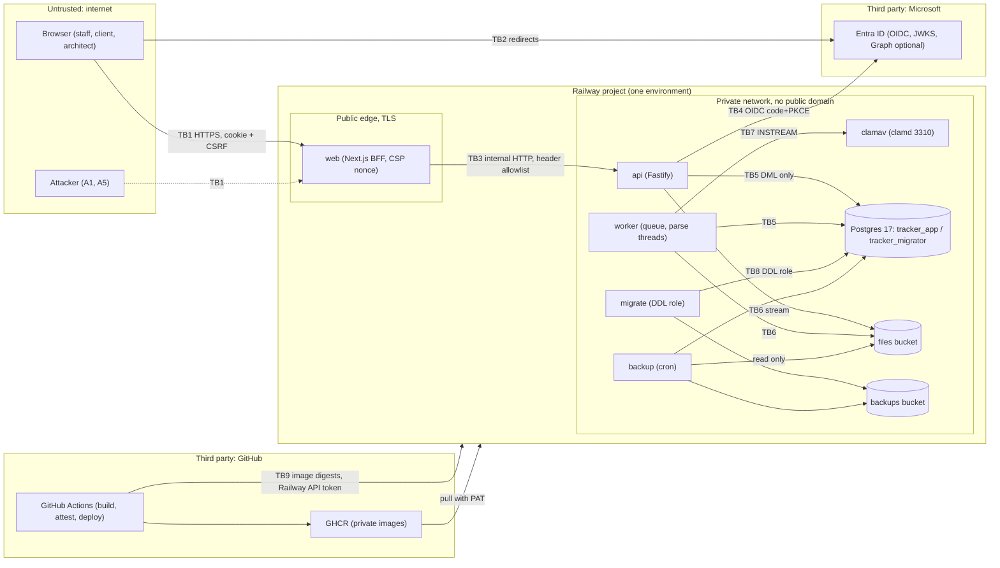

# Threat model — KR Subdivision Tracker

Owner: security CODEOWNER (`@cloudcitiwa/kr-tracker-security`). Method: STRIDE per component over the trust
boundaries below, ranked against ASVS 5.0 L2 (L3 for authentication, PRODUCT_SPEC section 14). Sources: ADR-0002,
0003, 0005, 0006, 0007, 0008, 0011, 0013, 0014, PRODUCT_SPEC sections 2.1, 3, 10, 11 and the code on `main`.
Review: whenever a trust boundary changes (checklist SC-C5), and before each go-live gate.

Status words: **Mitigated** (control plus a test that fails if it regresses), **Accepted** (known residual risk with
an owner), **Open** (a gap, with the issue to raise). Test paths are relative to the repository root; the
`services/api/test/security/` files are the WP-20 evidence suite (see
[Mitigations mapped to tests](#mitigations-mapped-to-tests)).

## 1. Scope and assumptions

- In scope: the `web` BFF, `api`, `worker`, the `migrate` and `backup` ops jobs, the files bucket, ClamAV, Microsoft
  Entra ID as identity provider, Railway as host, GitHub Actions as the delivery pipeline.
- Out of scope: Microsoft 365 tenant administration, KR staff endpoints (laptops, phones), the Railway platform
  internals, and future integrations (ADR-0012). Each is listed as a dependency with the assumption we make of it.
- Assumptions: TLS terminates at the Railway edge; Railway private networking is reachable only from services of the
  same environment; KR IT enforces Conditional Access (MFA) for admins in Entra; the Railway project and GitHub
  organisation have MFA on every human account.
- Attacker profiles: (A1) anonymous internet user; (A2) authenticated external (client or architect) trying to read
  or change another job; (A3) authenticated staff exceeding their role (for example reading fee proposals); (A4) a
  malicious or compromised uploader; (A5) a malicious web page driving a victim's browser (CSRF, login CSRF);
  (A6) a compromised dependency or CI step; (A7) a stolen secret (Railway token, bucket key, database URL).

## 2. Data classification

| Class        | Data                                                                                                   | Where                                         | Controls                                                                                                      |
| ------------ | ------------------------------------------------------------------------------------------------------ | --------------------------------------------- | ------------------------------------------------------------------------------------------------------------- |
| Restricted   | Client documents (decision letters, plans, fee proposals, emails), job details, client names/addresses | `files` bucket, `jobs`, `files`, `conditions` | Authz per request, 404 for invisible jobs, private bucket, no presigned URLs, no PII in logs, 30-day purge    |
| Confidential | User identity (name, email, Entra ids), grants, sessions, audit events                                 | `users`, `access_grants`, `sessions`, `audit` | Hashed session ids, immutable audit (app role cannot update or delete), pseudonymised in logs, audit kept 7 y |
| Secret       | `ENTRA_CLIENT_SECRET`, database URLs, bucket keys, `ANTHROPIC_API_KEY`, `RAILWAY_TOKEN`                | Railway sealed variables, GitHub environments | Sealed, per-service least privilege, 90-day rotation, never in logs/images/repo (gitleaks), agents never read |
| Internal     | Workflow definition, operations queue, metrics, logs                                                   | Postgres, Railway logs                        | Logs carry ids and event names only (BE-12), no bodies or query strings                                       |
| Public       | Sign-in page, `/healthz`, `/readyz`, static assets                                                     | `web`, `api`                                  | No data; health bodies are fixed                                                                              |

Personal data stays in Railway (region chosen by KR). The only third-party recipient is Anthropic, and only when the
`ai-stamp-reading` flag is on: the worker sends one rendered stamp image, never names or text (ADR-0010).

## 3. Trust boundaries

| Boundary | Crossing                  | What changes across it                                                                                             |
| -------- | ------------------------- | ------------------------------------------------------------------------------------------------------------------ |
| TB1      | Internet to `web`         | Everything is untrusted: URL, headers, cookies, bodies, files, `X-Forwarded-*` beyond the edge's own value         |
| TB2      | Browser to Entra          | Authentication ceremony; the browser carries the state and the authorization code back (login CSRF, open redirect) |
| TB3      | `web` to `api`            | The BFF forwards an allowlist of headers and the edge's `X-Forwarded-For`; the API trusts exactly one hop          |
| TB4      | `api` to Entra            | Back channel: discovery, token exchange, JWKS; authority host pinned outside local                                 |
| TB5      | Services to Postgres      | `tracker_app` has DML only and cannot touch `audit_events` rows or the schema; DDL exists only in `migrate`        |
| TB6      | Services to buckets       | Keys are `jobs/<jobId>/<fileId>`, never user input; the bucket is private                                          |
| TB7      | `worker` to `clamav`      | Untrusted bytes cross to a parser-heavy daemon; a missing verdict is never "clean"                                 |
| TB8      | `migrate` to Postgres     | The only holder of `MIGRATION_DATABASE_URL`; runs after a `pg_dump`                                                |
| TB9      | GitHub Actions to Railway | Deploys by attested digest only; the Railway token is the one long-lived credential (ADR-0008 exception 1)         |

## 4. STRIDE per component

Each row names the threat, the control that stops it and its status. Evidence is in section 5 (IDs `M-n`).

### 4.1 web (Next.js BFF, public)

| STRIDE | Threat                                                             | Control                                                                                                                                         | Status    | Ev.       |
| ------ | ------------------------------------------------------------------ | ----------------------------------------------------------------------------------------------------------------------------------------------- | --------- | --------- |
| S      | Forged identity headers or `Host` forwarded to the API             | Header allowlist inbound; `Authorization` and unknown headers dropped; API trusts only the session cookie                                       | Mitigated | M-20      |
| S      | Spoofed client IP defeats the sign-in limit                        | Edge's `X-Forwarded-For` forwarded unchanged; API trusts one hop and takes the address that hop saw (the address is not validated: finding D-1) | Mitigated | M-13      |
| T      | Script injection (XSS) through job text, file names or error pages | React escaping, no raw HTML; per-request nonce CSP with `strict-dynamic`, `object-src 'none'`, `base-uri 'none'`; names sanitised on upload     | Mitigated | M-19, M-9 |
| T      | Clickjacking, MIME sniffing, referrer leaks                        | `frame-ancestors 'none'`, `X-Frame-Options: DENY`, `nosniff`, `Referrer-Policy`, HSTS preload                                                   | Mitigated | M-19      |
| R      | User denies an action                                              | Request id end to end; audit event written in the same transaction as the change                                                                | Mitigated | M-17      |
| I      | Session cookie or CSRF token exposed to script                     | Session cookie `__Host-`, HttpOnly, Secure, SameSite=Lax; CSRF token only from `GET /v1/me`, never in storage the API reads                     | Mitigated | M-11      |
| I      | Upstream error bodies or stack traces reach the browser            | BFF maps transport failures to its own problem+json; API problems carry type and request id only                                                | Mitigated | M-20      |
| D      | Large or slow bodies exhaust the BFF                               | Streaming without buffering; API body limits behind it; Railway edge limits (no WAF, accepted risk R-3)                                         | Accepted  | M-8       |
| E      | Optimistic redirect page check mistaken for authorisation          | Redirect saves a round trip only; every API route authenticates and authorises on its own                                                       | Mitigated | M-1, M-3  |

### 4.2 api (Fastify, private)

| STRIDE | Threat                                                                                            | Control                                                                                                                                                               | Status    | Ev.        |
| ------ | ------------------------------------------------------------------------------------------------- | --------------------------------------------------------------------------------------------------------------------------------------------------------------------- | --------- | ---------- |
| S      | Route reachable without a session (a new handler forgets the hook)                                | Global `onRequest` hook authenticates everything except operations the contract marks public; unknown paths answer 401                                                | Mitigated | M-1, M-2   |
| S      | Session fixation, replay of an old id after sign-in, logout or role change                        | New 256-bit id per sign-in; presented session revoked; only SHA-256 stored; role change, disable and logout revoke                                                    | Mitigated | M-10       |
| S      | Login CSRF: attacker's callback URL signs the victim in as the attacker                           | `__Host-kr_auth` binding cookie checked against the flow; flow consumed even on mismatch                                                                              | Mitigated | M-12       |
| S      | Rogue identity provider (wrong authority host, wrong tenant, replayed or forged token)            | Authority pinned to Microsoft in staging/production (startup refuses otherwise); `tid`, `iss`, `aud`, `nonce`, PKCE, state checked by `openid-client`                 | Mitigated | M-14, M-15 |
| T      | Cross-site request forgery on a state-changing route                                              | `X-CSRF-Token` (constant-time) and exact `Origin` required on every non-safe method of an authenticated request; SameSite=Lax second layer                            | Mitigated | M-3        |
| T      | Mass assignment, malformed input, oversize JSON                                                   | zod schemas from `@kr/contracts` at the boundary (fail closed); `JSON_BODY_LIMIT_BYTES` 100 KB; JSON parser only                                                      | Mitigated | M-8        |
| T      | SQL injection                                                                                     | Kysely and parameterised queries only (BE-7); checked by review and CodeQL                                                                                            | Mitigated | M-22       |
| R      | Admin or staff action without a trace                                                             | `audit_events` written in the same transaction; app role cannot update or delete it; 7-year retention                                                                 | Mitigated | M-17       |
| I      | Broken object-level authorisation: another job's data by id (IDOR)                                | Every job-scoped handler resolves visibility first: unknown, archived and not-granted jobs are one 404; ids of another job (file, note, condition, operation) are 404 | Mitigated | M-5, M-6   |
| I      | Role escalation: staff reads fee proposals, client edits checkpoints, architect sees client files | Capability matrix in `@kr/contracts` is the only source; handler authz mandatory, a response without an authz check is replaced by an error (deny by default)         | Mitigated | M-4, M-16  |
| I      | Information in errors, logs or headers (stack traces, tokens, personal data, framework)           | problem+json with request id only; log redaction and pseudonyms; helmet headers; no `X-Powered-By`                                                                    | Mitigated | M-18, M-19 |
| D      | Brute force and flooding                                                                          | Postgres-backed limits per IP (sign-in 20/min) and per user (writes 120, uploads 30, reads 600); 429 with `Retry-After`; body limits                                  | Mitigated | M-13, M-8  |
| E      | Disabled or demoted user keeps access                                                             | Session lookup joins `users.status`; role changes revoke sessions; job visibility re-evaluated on every request                                                       | Mitigated | M-4, M-10  |
| E      | Admin pages without MFA evidence                                                                  | `REQUIRE_MFA_FOR_ADMIN` demands `amr` or `acrs` evidence on user and audit routes; which claim Entra emits is **unverified** (go-live gate)                           | Open      | M-4        |

### 4.3 worker (queue, parsing)

| STRIDE | Threat                                               | Control                                                                                                                                                      | Status    | Ev.  |
| ------ | ---------------------------------------------------- | ------------------------------------------------------------------------------------------------------------------------------------------------------------ | --------- | ---- |
| T      | Malicious PDF, `.msg` or `.eml` exploits the parser  | Parsing in a `worker_thread` with heap caps, time limit, page cap and empty environment; pdf.js with `isEvalSupported: false`; worker has no inbound network | Mitigated | M-21 |
| T      | Operation payload tampering through the queue        | Payloads validated with zod; `invalid_payload` fails the operation; handlers idempotent                                                                      | Mitigated | M-21 |
| I      | Document text or names reach logs or the AI provider | Audit rows carry ids and field names only; AI call sends one stamp image, behind a flag and a circuit breaker                                                | Mitigated | M-21 |
| D      | Decompression bomb, pathological PDF, stuck scan     | Memory sampling and kill, 60 s parse limit, lease with heartbeat, requeue sweep, `scan_pending_too_long` alert                                               | Mitigated | M-21 |
| E      | Compromised worker widens access                     | `tracker_app` role only (no DDL); `ANTHROPIC_API_KEY` exists only here; no `ENTRA_CLIENT_SECRET` or migration URL                                            | Mitigated | M-23 |

### 4.4 ops: migrate and backup

| STRIDE | Threat                              | Control                                                                                                                                                                                                                                  | Status    | Ev.  |
| ------ | ----------------------------------- | ---------------------------------------------------------------------------------------------------------------------------------------------------------------------------------------------------------------------------------------- | --------- | ---- |
| E      | The API obtains the DDL role        | Only `migrate` holds `MIGRATION_DATABASE_URL`; compose gives api, worker, web and mock-idp an explicit variable list that omits it, whatever the shell or `.env` holds (`infra/test/compose-stack.test.mjs`); app role cannot DDL (DB-6) | Mitigated | M-23 |
| T      | Bad or malicious migration          | Forward-only, checksummed, advisory lock, `lock_timeout`; Squawk in CI; migrations are protected paths; pre-migration `pg_dump`                                                                                                          | Mitigated | M-23 |
| I      | Backups leak data                   | Private second bucket written only by `migrate` and `backup`; `backup` reads files with read-only keys                                                                                                                                   | Accepted  | M-23 |
| D      | Failed backup unnoticed             | `backup-failed` alert and runbook; 35-day retention; quarterly restore drill                                                                                                                                                             | Mitigated | M-23 |
| R      | Operator promotes an admin silently | `promote-admin` CLI writes an audit event                                                                                                                                                                                                | Mitigated | M-17 |

### 4.5 storage (files bucket)

| STRIDE | Threat                                                  | Control                                                                                                                                                      | Status    | Ev.       |
| ------ | ------------------------------------------------------- | ------------------------------------------------------------------------------------------------------------------------------------------------------------ | --------- | --------- |
| T      | Path traversal or key injection through file names      | Object key is `jobs/<jobId>/<fileId>` from ids the server generated; display names sanitised (no separators or control characters, 255 chars)                | Mitigated | M-9       |
| T      | Polyglot or mislabelled upload served as active content | Content sniffing against the slot's accepted kinds (415 and object deleted); inline only for safe kinds; `nosniff`; restrictive CSP and `sandbox` on non-PDF | Mitigated | M-9, M-19 |
| I      | Public or presigned object access                       | Bucket private; no presigned URLs; every read streams through the API after authorisation, so revocation applies                                             | Mitigated | M-5       |
| D      | Oversize upload                                         | `UPLOAD_MAX_BYTES` enforced while streaming (413); 30 uploads per minute per user                                                                            | Mitigated | M-9       |
| T      | Object tampering or loss                                | sha256 recorded; no object versioning assumed (accepted); nightly copy to the backups bucket                                                                 | Accepted  | M-23      |

### 4.6 ClamAV

| STRIDE | Threat                                                   | Control                                                                                                                          | Status    | Ev.  |
| ------ | -------------------------------------------------------- | -------------------------------------------------------------------------------------------------------------------------------- | --------- | ---- |
| T      | Infected file served to users                            | Content served only when `scan_status` is clean (or skipped, local only); infected objects deleted, audited, alerted             | Mitigated | M-5  |
| D      | clamd down or stream cut at its limit lets files through | No verdict is never clean: file stays `pending`, retried, `error` after attempts; clamd limits above `UPLOAD_MAX_BYTES` (tested) | Mitigated | M-21 |
| E      | Daemon compromise through a crafted file                 | Private service, no inbound from the internet, official pinned image, signatures updated by freshclam; limits on scan size       | Accepted  | M-21 |
| I      | Stale signatures leave new malware undetected            | freshclam updates signatures; ADR-0009 plans a 48 h staleness alert, but `docs/observability/alerts.md` does not define it yet   | Open      | M-21 |

### 4.7 Entra ID (third party)

| STRIDE | Threat                                                                        | Control                                                                                                                                     | Status    | Ev.  |
| ------ | ----------------------------------------------------------------------------- | ------------------------------------------------------------------------------------------------------------------------------------------- | --------- | ---- |
| S      | Account from another tenant signs in                                          | `tid` must equal the configured tenant (`wrong_tenant`); identity key is (`tid`, `oid`), never email                                        | Mitigated | M-15 |
| S      | Guest with an unverified or mutable email takes over a grant or becomes admin | Guest grants match the `email` claim only, not when `xms_edov=false`; guests are never first-admin eligible; staff domain rule uses the UPN | Mitigated | M-15 |
| S      | Authorization-code interception                                               | Confidential client with PKCE S256, state and nonce stored server side for 10 minutes                                                       | Mitigated | M-14 |
| D      | Entra outage blocks sign-in                                                   | Existing sessions keep working; sign-in fails with a retry page; accepted (no local credentials by design)                                  | Accepted  | M-14 |
| E      | Admin without MFA                                                             | Conditional Access in Entra plus the API's evidence check (see 4.2)                                                                         | Open      | M-4  |

### 4.8 Railway (third party host)

| STRIDE | Threat                                                   | Control                                                                                                                             | Status    | Ev.  |
| ------ | -------------------------------------------------------- | ----------------------------------------------------------------------------------------------------------------------------------- | --------- | ---- |
| E      | Internal service exposed on a public domain              | Only `web` gets a domain (deploy guide); the API has no auth bypass for internal callers, so exposure would still require a session | Accepted  | M-24 |
| I      | Secrets visible to Railway operators or in the dashboard | Sealed variables, least privilege per service; platform operators are a trusted party (accepted)                                    | Accepted  | M-24 |
| D      | No WAF or edge rate limit                                | Limits in API and BFF; optional Cloudflare in front for production (ADR-0008 exception 6)                                           | Accepted  | M-13 |
| T      | Service source swapped for an unattested image           | Services deployed from image digests only; `deploy.yml` verifies attestations; Railway never builds from source                     | Mitigated | M-24 |
| S      | Forwarded-header trust wrong (extra hop, or none)        | `TRUST_PROXY_HOPS=1`, proved in staging with the documented procedure; tests cover spoofed prefixes                                 | Mitigated | M-13 |

### 4.9 GitHub Actions and the supply chain

| STRIDE | Threat                                           | Control                                                                                                                                                | Status    | Ev.  |
| ------ | ------------------------------------------------ | ------------------------------------------------------------------------------------------------------------------------------------------------------ | --------- | ---- |
| T      | Compromised third-party action or dependency     | Actions pinned to commit SHAs, `permissions: {}` by default, dependency review, Renovate, lockfile, SBOM and Grype, CodeQL, zizmor                     | Mitigated | M-24 |
| S      | Unreviewed change reaches production             | CODEOWNERS with security and platform teams on protected paths; two approvals for High tier; `playbook-guard`; `production` environment with reviewers | Mitigated | M-24 |
| E      | Stolen `RAILWAY_TOKEN` deploys arbitrary images  | Scoped per environment, stored as an environment secret, 90-day rotation, attestation check in the workflow; Railway cannot federate OIDC (accepted)   | Accepted  | M-24 |
| T      | A prompt-injected agent edits instructions or CI | Protected paths (CODEOWNERS, hook, guard); agents cannot approve or merge; no production credentials in sessions                                       | Mitigated | M-24 |
| I      | Secrets committed                                | gitleaks pre-commit and in CI; `.env.example` placeholders only                                                                                        | Mitigated | M-24 |

## 5. Mitigations mapped to tests

`T` = test file. Unit and integration tests outside `services/api/test/security/` already exist on `main`; the
security suite adds the cross-cutting, route-by-route evidence a reviewer needs in one place.

| ID   | Control                                                                            | Evidence (test files)                                                                                                                                                                                            |
| ---- | ---------------------------------------------------------------------------------- | ---------------------------------------------------------------------------------------------------------------------------------------------------------------------------------------------------------------- |
| M-1  | Every contract operation is registered, nothing else (strict equality)             | `services/api/test/security/route-completeness.int.test.ts`; `services/api/src/app.test.ts`                                                                                                                      |
| M-2  | Every non-public route answers 401 without a valid session; public set is fixed    | `services/api/test/security/route-completeness.int.test.ts`; `services/api/src/platform/session-auth.int.test.ts`                                                                                                |
| M-3  | Every write route answers 403 without CSRF token or with a bad Origin              | `services/api/test/security/route-completeness.int.test.ts`; `services/api/src/platform/csrf.int.test.ts`                                                                                                        |
| M-4  | Authorisation matrix: every section 2.1 row for every role, disabled users, MFA    | `services/api/test/security/authz-matrix.int.test.ts`; `services/api/src/platform/authz.int.test.ts`; `packages/contracts/src/permissions.test.ts`                                                               |
| M-5  | Job-scoped ids of another job are 404; evidence of another job's condition refused | `services/api/test/security/idor.int.test.ts`; `services/api/src/modules/jobs/http/get-job.int.test.ts`; `services/api/src/modules/files/http/get-file.int.test.ts`                                              |
| M-6  | Visibility re-evaluated per request (revoked grant, archived job)                  | `services/api/test/security/idor.int.test.ts`; `services/api/src/modules/_shared/jobs-visibility.int.test.ts`                                                                                                    |
| M-8  | Body and JSON limits, 413/415, single JSON parser                                  | `services/api/src/platform/body-limit.int.test.ts`; `services/api/test/security/upload-abuse.int.test.ts`                                                                                                        |
| M-9  | Upload abuse: polyglots, oversize, traversal names, wrong slot                     | `services/api/test/security/upload-abuse.int.test.ts`; `services/api/src/modules/files/http/upload-file.int.test.ts`; `services/api/src/modules/files/http/upload-authorisation.int.test.ts`                     |
| M-10 | Session rotation, fixation, revocation on logout, role change and disable          | `services/api/test/security/session.int.test.ts`; `services/api/src/platform/session.int.test.ts`; `services/api/src/modules/auth/http/complete-login.security.int.test.ts`                                      |
| M-11 | Cookie flags (`__Host-`, HttpOnly, Secure, SameSite=Lax) and CSRF token delivery   | `services/api/test/security/session.int.test.ts`; `services/api/src/modules/auth/http/session-routes.int.test.ts`                                                                                                |
| M-12 | Login CSRF: callback without or with the wrong binding cookie                      | `services/api/test/security/login-csrf.int.test.ts`; `services/api/src/modules/auth/http/browser-binding.test.ts`                                                                                                |
| M-13 | Per-IP sign-in limit with spoofed `X-Forwarded-For` prefixes; per-user limits      | `services/api/test/security/client-ip.int.test.ts`; `services/api/src/platform/rate-limit.int.test.ts`; `apps/web/src/lib/bff/headers.test.ts`                                                                   |
| M-14 | State, nonce, PKCE and code tampering; `ENTRA_AUTHORITY_HOST` pinning              | `services/api/test/security/entra-authority.int.test.ts`; `services/api/src/modules/auth/http/complete-login.security.int.test.ts`; `services/api/src/config.test.ts`                                            |
| M-15 | Tenant, guest email and first-admin rules                                          | `services/api/src/modules/auth/http/complete-login.int.test.ts`; `services/api/src/modules/auth/http/first-admin.int.test.ts`; `services/api/src/modules/auth/http/guest-conversion.int.test.ts`                 |
| M-16 | A handler that never calls an authz helper cannot answer                           | `services/api/src/platform/routes.test.ts`; `services/api/src/platform/authz.test.ts`                                                                                                                            |
| M-17 | Audit in the same transaction; append-only for the app role                        | `services/api/src/platform/audit.int.test.ts`; `packages/db/src/schema.int.test.ts`; `services/api/src/cli/promote-admin.int.test.ts`                                                                            |
| M-18 | Problem+json without internals; logs without secrets                               | `services/api/src/platform/errors.http.int.test.ts`; `packages/logger/src/index.test.ts`; `packages/telemetry/src/scrub.test.ts`                                                                                 |
| M-19 | Security headers on the API (including the content endpoint) and the web app       | `services/api/test/security/headers.int.test.ts`; `services/api/src/platform/security-headers.test.ts`; `apps/web/src/lib/security/csp.test.ts`; `apps/web/src/lib/security/headers.test.ts`                     |
| M-20 | BFF header allowlist, problem mapping, streaming                                   | `apps/web/src/lib/bff/headers.test.ts`; `apps/web/src/lib/bff/proxy.test.ts`; `apps/web/src/app/api/v1/[...path]/route.test.ts`                                                                                  |
| M-21 | Worker isolation, scan failure handling, limits, ClamAV limits                     | `services/worker/src/parsing/isolate.int.test.ts`; `services/worker/src/handlers/limits.int.test.ts`; `services/worker/src/handlers/file-scan.int.test.ts`; `infra/clamav/test/scan-limits.test.mjs`             |
| M-22 | Parameterised SQL only                                                             | CodeQL (`security.yml`); review checklist SC-B2                                                                                                                                                                  |
| M-23 | Least-privilege roles, migration and backup behaviour                              | `packages/db/src/schema.int.test.ts`; `services/ops/src/migrate-service.int.test.ts`; `services/ops/src/backup-service.int.test.ts`; `infra/railway/test/settings.test.mjs`; `infra/test/compose-stack.test.mjs` |
| M-24 | Delivery chain: pinned actions, attestation, private topology, ZAP baseline        | `infra/railway/test/deploy-images.test.mjs`; `infra/railway/test/smoke.test.mjs`; `.github/workflows/security.yml`; `docs/security/zap.md`                                                                       |

M-7 is intentionally unused (kept so IDs match the review notes).

Related records: `findings.md` (defects the suite found: D-1 to D-5, with reproductions), `zap.md` (DAST baseline rules
and how they were derived) and `mutation-runner.md` (Stryker runner check and timings).

## 6. Residual risks and follow-ups

| ID  | Risk                                                                                                                                              | Owner              | Next step                                                                                  |
| --- | ------------------------------------------------------------------------------------------------------------------------------------------------- | ------------------ | ------------------------------------------------------------------------------------------ |
| R-1 | Entra may not emit `amr`/`acrs` for this app registration: admin pages locked or unprotected                                                      | Security CODEOWNER | Prove one claim in staging before go-live (deploy guide); then record the result here      |
| R-2 | Railway buckets have no versioning; a bad delete or overwrite is recoverable only from backup                                                     | Platform           | Verify bucket features in staging; keep the quarterly restore drill                        |
| R-3 | No WAF or edge rate limit on the public domain                                                                                                    | Platform           | Cloudflare in front of production (needs KR DNS)                                           |
| R-4 | Railway token is a long-lived credential                                                                                                          | Platform           | 90-day rotation; revisit when Railway offers OIDC federation                               |
| R-5 | ClamAV is signature based: a novel file passes                                                                                                    | Security CODEOWNER | Accepted; inline-only types are restricted and sandboxed, others download as attachments   |
| R-6 | Defects found by the WP-20 suite: D-1 unvalidated client address, D-2 over-long path parameter, D-3 no CSP on framework 404 pages (`findings.md`) | Orchestrator       | Raise one issue per defect; fix in the owning module (WP-20 does not change other modules) |
| R-7 | The ClamAV signature-staleness alert named in ADR-0009 is not yet in `docs/observability/alerts.md`                                               | Platform           | Add the alert and its runbook (observability owner)                                        |
